# StackFlowServer: diseño de clases del REST unificado

> **Prevalecen [DECISIONES.md](DECISIONES.md) y [DISENO_REVISION_2.md](DISENO_REVISION_2.md)**: módulos, nombres de clases (tabla §11), perfiles `pegasus`/`modelforge` y alcance. Este documento sigue valiendo en lo que aquellos no cambian.
>
> **Copia canónica para la implementación v2** (rama `v2`, `docs/v2/design/`). Los roles definitivos son `VIEWER`, `ANALYST`, `AUDITOR` y `ADMIN` (Anexo A.5 de DISENO_REST_UNIFICADO.md).


Versión 1 · 15.10.2026 · Complementa a [DISENO_REST_UNIFICADO.md](DISENO_REST_UNIFICADO.md) (decisiones, endpoints, plan).
Los diagramas están en inglés y cada uno aparece dos veces, en **Mermaid** y en **PlantUML**. Las explicaciones están en español.

**Reglas que respetan todos los diagramas**
- **MerLabCore y MerLabRAG no se modifican.** Se usan como JAR tal cual. Las clases marcadas `«library»` ya existen y solo se usan.
- **Los miniservers no se tocan** y el REST no los llama nunca.
- Todo lo nuevo vive en StackFlowServer, paquete raíz `com.merlab.stackflow`.
- **MerLabRAG es opcional:** sin su JAR, StackFlow funciona solo con MerLabCore (secciones 3.10, 4.6 y 5.6).

**Leyenda de estereotipos**

| Estereotipo | Significado |
|---|---|
| `«resource»` | recurso JAX-RS (capa web) |
| `«dto»` | record de entrada o salida HTTP (módulo `stackflow-api`) |
| `«service»` | servicio de aplicación (CDI `@ApplicationScoped` o EJB `@Stateless`) |
| `«port»` | interfaz que el servicio necesita y que un adaptador implementa |
| `«adapter»` | implementación de un port contra una librería o la BD |
| `«domain»` | record o clase interna de StackFlow (no es DTO HTTP) |
| `«library»` | clase existente de MerLabCore o MerLabRAG, **sin cambios** |
| `«entity»` | entidad JPA |

**Índice**
1. [Componentes y despliegue](#1-componentes-y-despliegue)
2. [Módulos y dependencias](#2-módulos-y-dependencias)
3. [Diagramas de clases](#3-diagramas-de-clases)
   - [3.1 Capa web](#31-capa-web)
   - [3.2 DTOs de la API](#32-dtos-de-la-api)
   - [3.3 Servicios y sistema de jobs](#33-servicios-y-sistema-de-jobs)
   - [3.4 Ports y modelo de dominio](#34-ports-y-modelo-de-dominio)
   - [3.5 Adaptador MerLabCore](#35-adaptador-merlabcore)
   - [3.6 Adaptador MerLabRAG](#36-adaptador-merlabrag)
   - [3.7 Persistencia](#37-persistencia)
   - [3.8 Errores](#38-errores)
   - [3.9 Conversaciones y logs completos](#39-conversaciones-y-logs-completos-4-endpoints-añadidos)
   - [3.10 Modo sin RAG](#310-modo-sin-rag-merlabrag-opcional)
4. [Diagramas de estado](#4-diagramas-de-estado)
5. [Diagramas de secuencia](#5-diagramas-de-secuencia)
6. [Modelo de datos (ER)](#6-modelo-de-datos-er)
7. [Tablas de mapeo](#7-tablas-de-mapeo)

---

## 1. Componentes y despliegue

**Qué muestra:** cómo queda todo en tiempo de ejecución. Hay un solo WildFly y un solo WAR. Dentro del WAR están las dos librerías como JAR. Los servicios externos (Ollama, Qdrant, pgvector, Neo4j, Redis, MariaDB) se configuran en WildFly. Los dos miniservers siguen existiendo, pero solo en desarrollo y sin conexión con el WAR.

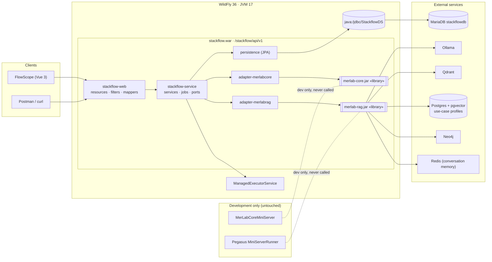

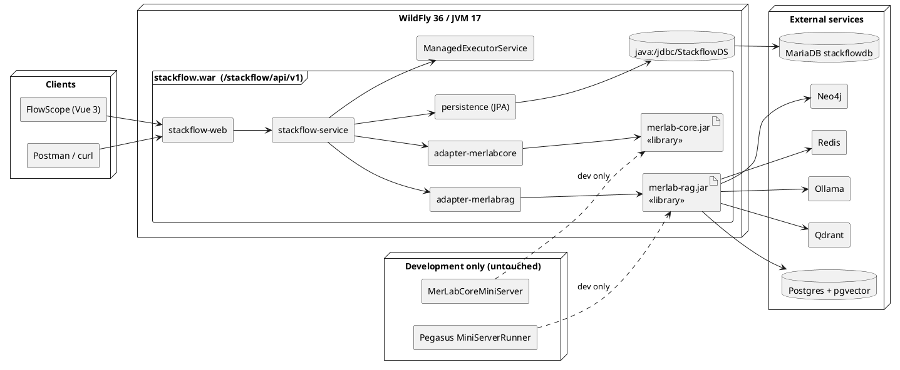

---

## 2. Módulos y dependencias

**Qué muestra:** los cinco módulos Maven de StackFlow y en qué dirección pueden depender unos de otros.
- `stackflow-api` solo contiene DTOs y no depende de nada.
- `stackflow-service` define los **ports** y no conoce ninguna librería.
- Los **adaptadores** son los únicos que importan `com.merlab.signals.*` o `pegasus.*`.
- `stackflow-web` empaqueta el WAR y conecta todo con CDI.
- `stackflow-adapter-merlabrag` es **opcional** (perfil Maven `rag`). Sin MerLabRAG instalado, el WAR se genera sin él y StackFlow funciona solo con MerLabCore (sección 3.10).

Estas reglas se pueden comprobar con ArchUnit, igual que ya haces en MerLabRAG.

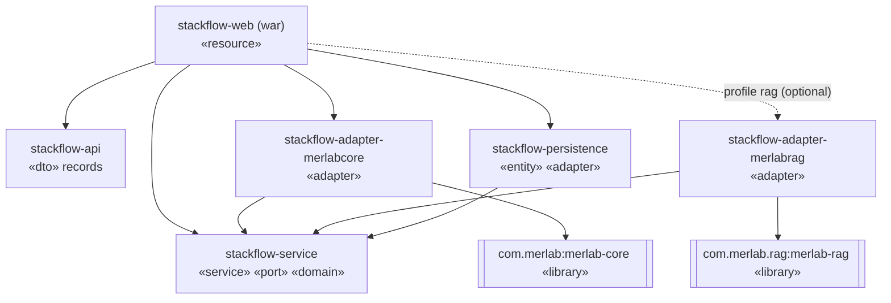

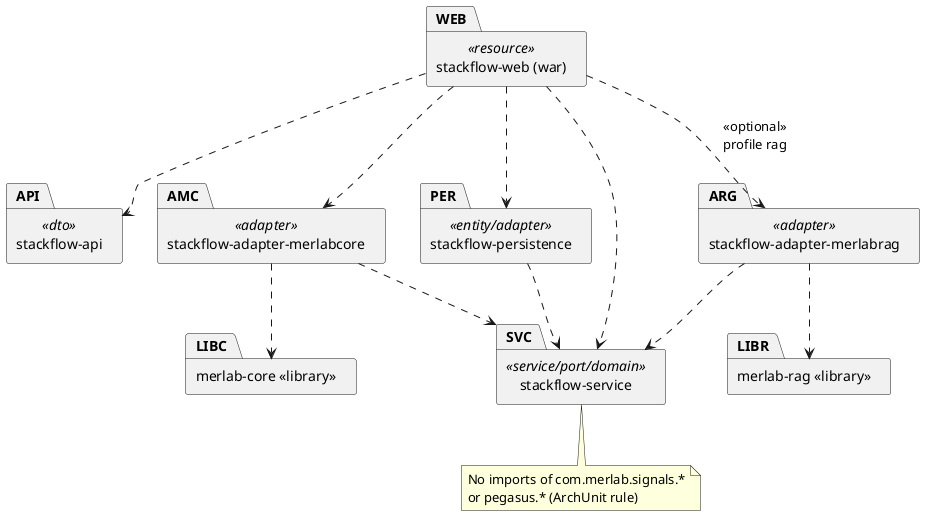

| Regla | Comprobación |
|---|---|
| `service` no importa `pegasus..` ni `com.merlab.signals..` | ArchUnit `noClasses().that().resideInAPackage("..service..")…` |
| `web` no importa adaptadores directamente (solo vía CDI) | ArchUnit |
| `api` no depende de ningún otro módulo | Maven (sin dependencias) |
| Solo los adaptadores usan clases `«library»` | ArchUnit |

---

## 3. Diagramas de clases

### 3.1 Capa web

**Qué muestra:** los recursos JAX-RS agrupados por área. Cada recurso es delgado:
1. valida el DTO (Bean Validation),
2. llama a **un** servicio,
3. convierte el resultado con `ApiMapper`.

No hay lógica de negocio en esta capa. `CorrelationIdFilter` pone `X-Correlation-Id` en el MDC y en la respuesta. `JwtAuthFilter` llena el `SecurityContext` para que funcione `@RolesAllowed`. Todos los errores salen por `StackflowExceptionMapper` (sección 3.8).

```mermaid
classDiagram
    direction LR

    class StackflowApplication {
        <<ApplicationPath api/v1>>
    }

    class HealthResource {
        <<resource>>
        +live() Response
        +ready() Response
    }
    class InfoResource {
        <<resource>>
        +info() InfoResponse
    }
    class AdminResource {
        <<resource>>
        +components() ComponentsResponse
    }
    class AuthResource {
        <<resource>>
        +login(LoginRequest) TokenResponse
    }
    class UserResource {
        <<resource, existing>>
        +list() List~UserDTO~
        +get(id) UserDTO
        +create(UserDTO) Response
        +update(id, UserDTO) UserDTO
        +delete(id) Response
    }

    class MlAlgorithmResource {
        <<resource>>
        +list(q, status, category) AlgorithmListResponse
        +get(id) AlgorithmResponse
        +components() AlgorithmListResponse
        +catalog() AlgorithmListResponse
        +run(id, RunRequest) Response
    }
    class MlExampleResource {
        <<resource>>
        +list() ExampleListResponse
        +run(key, RunRequest) Response
    }
    class StackResource {
        <<resource>>
        +evaluate(RpnRequest) RpnResponse
    }
    class PipelineResource {
        <<resource>>
        +crud()
        +run(id, RunRequest) Response
    }
    class ScenarioResource {
        <<resource>>
        +crud()
        +run(id, RunRequest) Response
    }
    class SignalResource {
        <<resource>>
        +crud()
        +data(id) SignalDataResponse
    }

    class RagQueryResource {
        <<resource>>
        +query(QueryRequest, mode) Response
    }
    class RagUseCaseResource {
        <<resource>>
        +useCases() UseCaseResponse
        +flows() FlowListResponse
    }
    class RagConversationResource {
        <<resource>>
        +list() ConversationListResponse
        +get(sessionId) ConversationResponse
        +messages(sessionId, limit) ConversationMessagesResponse
        +delete(sessionId) ConversationResponse
    }
    class RagScenarioResource {
        <<resource>>
        +run(name) Response
    }
    class RagRunLogResource {
        <<resource>>
        +list(limit) RunLogListResponse
        +get(id) RunLogResponse
        +raw(id) String
        +analysis(id) RunLogAnalysisResponse
    }

    class JobResource {
        <<resource>>
        +create(CreateJobRequest) Response
        +list(type, status, limit) JobListResponse
        +get(jobId) JobResponse
        +events(jobId, after) JobEventsResponse
        +result(jobId) JobResultResponse
        +cancel(jobId) Response
    }
    class JobEventsSocket {
        <<ServerEndpoint ws/jobs/id>>
        +onOpen(session, jobId)
        +onClose(session)
    }

    class CorrelationIdFilter {
        <<ContainerRequestFilter, ContainerResponseFilter>>
    }
    class JwtAuthFilter {
        <<ContainerRequestFilter>>
    }
    class StackflowExceptionMapper {
        <<ExceptionMapper>>
    }
    class ConstraintViolationMapper {
        <<ExceptionMapper>>
    }
    class ApiMapper {
        <<static>>
        +toQueryResponse(RagResult) QueryResponse
        +toAlgorithm(AlgorithmInfo) AlgorithmResponse
        +toJob(Job) JobResponse
        +toEvents(JobId, List~JobEvent~) JobEventsResponse
        +toRagQuery(QueryRequest) RagQuery
    }

    StackflowApplication o-- HealthResource
    StackflowApplication o-- MlAlgorithmResource
    StackflowApplication o-- RagQueryResource
    StackflowApplication o-- JobResource
    StackflowApplication o-- CorrelationIdFilter
    StackflowApplication o-- JwtAuthFilter
    StackflowApplication o-- StackflowExceptionMapper

    HealthResource --> HealthService
    InfoResource --> HealthService
    AdminResource --> HealthService
    MlAlgorithmResource --> MlService
    MlExampleResource --> MlService
    StackResource --> MlService
    PipelineResource --> PipelineService
    ScenarioResource --> PipelineService
    RagQueryResource --> RagService
    RagUseCaseResource --> RagService
    RagConversationResource --> RagService
    RagScenarioResource --> RagService
    RagRunLogResource --> RagService
    JobResource --> JobService
    JobEventsSocket --> JobService
    RagQueryResource ..> ApiMapper
    JobResource ..> ApiMapper
    MlAlgorithmResource ..> ApiMapper
```

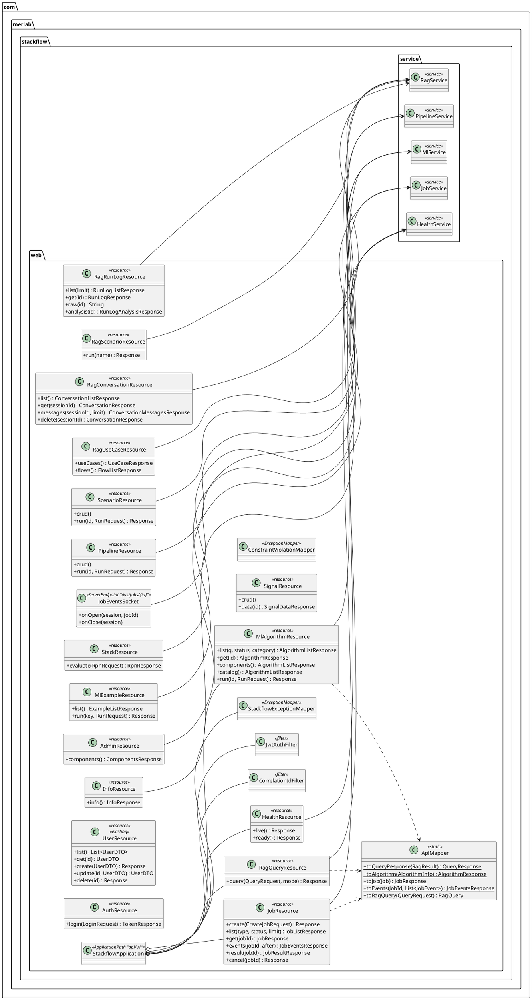

**Notas**
- `RagQueryResource.query(..., mode)`: con `?mode=sync` (por defecto) responde `200` o `422`. Con `?mode=async` responde `202` + `Location: /jobs/{id}`.
- `MlAlgorithmResource.run` y `MlExampleResource.run` son **asíncronos por defecto** (`202`). Ver el diagrama de estado 4.1.
- `UserResource` y sus DTOs ya existen. Solo cambia el prefijo (`/api/v1/users`).

---

### 3.2 DTOs de la API

**Qué muestra:** los records que viajan por HTTP (módulo `stackflow-api`). Los DTOs de RAG tienen **la misma forma que el contrato de la empresa** (`QueryRequest`, `QueryResponse`, `ConversationResponse`, `JobEventsResponse`…), pero están escritos en tus paquetes. Los estados viajan como `String` para que `api` no dependa de los enums del servicio.

```mermaid
classDiagram
    direction LR

    class QueryRequest {
        <<dto>>
        +String useCaseId
        +String sessionId
        +String userInput
        +String orchestrationMode
    }
    class QueryResponse {
        <<dto>>
        +boolean success
        +boolean valid
        +String useCaseId
        +String outputFormat
        +String finalOutput
        +List~ArtifactResponse~ artifacts
        +List~QueryErrorResponse~ errors
        +TraceResponse trace
        +AuditResponse auditResponse
    }
    class ArtifactResponse {
        <<dto>>
        +String type
        +String id
        +double score
        +String text
    }
    class QueryErrorResponse {
        <<dto>>
        +String code
        +String message
        +String severity
    }
    class TraceResponse {
        <<dto>>
        +String traceId
        +String flowName
        +String orchestrationMode
        +List~TraceEventResponse~ events
    }
    class TraceEventResponse {
        <<dto>>
        +String operator
        +String type
        +long durationMs
    }
    class AuditResponse {
        <<dto>>
        +String validation
        +String security
        +Map quality
    }
    class UseCaseResponse {
        <<dto>>
        +List~UseCaseItem~ useCases
    }
    class UseCaseItem {
        <<dto>>
        +String id
        +String title
        +String description
        +String type
        +String defaultFlow
        +List~String~ tags
    }
    class ConversationResponse {
        <<dto>>
        +String sessionId
        +boolean exists
        +boolean memoryConfigured
        +int messageCount
        +Long lastActivityEpochMs
        +String state
    }

    class AlgorithmResponse {
        <<dto>>
        +String id
        +List~String~ aliases
        +String displayName
        +String category
        +String description
        +String status
        +List~String~ parameters
        +boolean executable
    }
    class AlgorithmListResponse {
        <<dto>>
        +int total
        +List~AlgorithmResponse~ items
    }
    class RunRequest {
        <<dto>>
        +Map params
        +String mode
    }
    class MlRunResponse {
        <<dto>>
        +boolean success
        +String consoleOutput
        +String chartHtml
        +Map metrics
    }
    class RpnRequest {
        <<dto>>
        +String expression
        +Map inputs
    }
    class RpnResponse {
        <<dto>>
        +List~Double~ values
        +int size
    }

    class CreateJobRequest {
        <<dto>>
        +String type
        +Map payload
    }
    class JobResponse {
        <<dto>>
        +String jobId
        +String type
        +String status
        +String createdAt
        +String startedAt
        +String finishedAt
        +String correlationId
    }
    class JobEventsResponse {
        <<dto>>
        +String jobId
        +String status
        +long nextSequence
        +List~JobEventResponse~ events
    }
    class JobEventResponse {
        <<dto>>
        +long sequence
        +String timestamp
        +String node
        +String status
        +String message
    }
    class JobResultResponse {
        <<dto>>
        +String jobId
        +String status
        +Object result
        +String completedAt
    }

    class HealthResponse {
        <<dto>>
        +String status
        +List~ComponentHealth~ components
    }
    class ComponentHealth {
        <<dto>>
        +String name
        +String status
        +String detail
    }
    class ErrorResponse {
        <<dto>>
        +String code
        +int status
        +String message
        +String correlationId
        +List~ErrorDetail~ details
    }
    class ErrorDetail {
        <<dto>>
        +String field
        +String message
    }

    QueryResponse *-- ArtifactResponse
    QueryResponse *-- QueryErrorResponse
    QueryResponse *-- TraceResponse
    QueryResponse *-- AuditResponse
    TraceResponse *-- TraceEventResponse
    UseCaseResponse *-- UseCaseItem
    AlgorithmListResponse *-- AlgorithmResponse
    JobEventsResponse *-- JobEventResponse
    HealthResponse *-- ComponentHealth
    ErrorResponse *-- ErrorDetail
```

```plantuml
@startuml api-dtos
left to right direction
skinparam classAttributeIconSize 0

package "com.merlab.stackflow.api.rag" {
  class QueryRequest <<dto>> {
    +useCaseId : String  {@NotBlank}
    +sessionId : String  {@NotBlank}
    +userInput : String  {@NotBlank}
    +orchestrationMode : String
  }
  class QueryResponse <<dto>> {
    +success : boolean
    +valid : boolean
    +useCaseId : String
    +outputFormat : String
    +finalOutput : String
    +artifacts : List<ArtifactResponse>
    +errors : List<QueryErrorResponse>
    +trace : TraceResponse
    +auditResponse : AuditResponse
  }
  class ArtifactResponse <<dto>> {
    +type : String
    +id : String
    +score : double
    +text : String
  }
  class QueryErrorResponse <<dto>> {
    +code : String
    +message : String
    +severity : String
  }
  class TraceResponse <<dto>> {
    +traceId : String
    +flowName : String
    +orchestrationMode : String
    +events : List<TraceEventResponse>
  }
  class TraceEventResponse <<dto>> {
    +operator : String
    +type : String
    +durationMs : long
  }
  class AuditResponse <<dto>> {
    +validation : String
    +security : String
    +quality : Map<String,Object>
  }
  class UseCaseResponse <<dto>> {
    +useCases : List<UseCaseItem>
  }
  class UseCaseItem <<dto>> {
    +id : String
    +title : String
    +description : String
    +type : String
    +defaultFlow : String
    +tags : List<String>
  }
  class ConversationResponse <<dto>> {
    +sessionId : String
    +exists : boolean
    +memoryConfigured : boolean
    +messageCount : int
    +lastActivityEpochMs : Long
    +state : String
  }
}

package "com.merlab.stackflow.api.ml" {
  class AlgorithmResponse <<dto>> {
    +id : String
    +aliases : List<String>
    +displayName : String
    +category : String
    +description : String
    +status : String
    +parameters : List<String>
    +executable : boolean
  }
  class AlgorithmListResponse <<dto>> {
    +total : int
    +items : List<AlgorithmResponse>
  }
  class RunRequest <<dto>> {
    +params : Map<String,Object>
    +mode : String
  }
  class MlRunResponse <<dto>> {
    +success : boolean
    +consoleOutput : String
    +chartHtml : String
    +metrics : Map<String,Double>
  }
  class RpnRequest <<dto>> {
    +expression : String
    +inputs : Map<String,List<Double>>
  }
  class RpnResponse <<dto>> {
    +values : List<Double>
    +size : int
  }
}

package "com.merlab.stackflow.api.job" {
  class CreateJobRequest <<dto>> {
    +type : String
    +payload : Map<String,Object>
  }
  class JobResponse <<dto>> {
    +jobId : String
    +type : String
    +status : String
    +createdAt : String
    +startedAt : String
    +finishedAt : String
    +correlationId : String
  }
  class JobEventsResponse <<dto>> {
    +jobId : String
    +status : String
    +nextSequence : long
    +events : List<JobEventResponse>
  }
  class JobEventResponse <<dto>> {
    +sequence : long
    +timestamp : String
    +node : String
    +status : String
    +message : String
  }
  class JobResultResponse <<dto>> {
    +jobId : String
    +status : String
    +result : Object
    +completedAt : String
  }
}

package "com.merlab.stackflow.api.common" {
  class HealthResponse <<dto>> {
    +status : String
    +components : List<ComponentHealth>
  }
  class ComponentHealth <<dto>> {
    +name : String
    +status : String
    +detail : String
  }
  class ErrorResponse <<dto>> {
    +code : String
    +status : int
    +message : String
    +correlationId : String
    +details : List<ErrorDetail>
  }
  class ErrorDetail <<dto>> {
    +field : String
    +message : String
  }
}

QueryResponse *-- ArtifactResponse
QueryResponse *-- QueryErrorResponse
QueryResponse *-- TraceResponse
QueryResponse *-- AuditResponse
TraceResponse *-- TraceEventResponse
UseCaseResponse *-- UseCaseItem
AlgorithmListResponse *-- AlgorithmResponse
JobEventsResponse *-- JobEventResponse
HealthResponse *-- ComponentHealth
ErrorResponse *-- ErrorDetail
@enduml
```

**Notas**
- `JobResultResponse.result` es polimórfico: `QueryResponse` para jobs RAG y `MlRunResponse` para jobs ML. Jackson lo serializa según el `type` del job.
- `ConversationResponse.state` toma los valores `FOUND`, `EMPTY` o `MEMORY_NOT_CONFIGURED`, igual que el contrato de la empresa. Ver el diagrama de estado 4.4.

---

### 3.3 Servicios y sistema de jobs

**Qué muestra:** el corazón de StackFlow.
- Hay **cuatro servicios de área**: `MlService`, `PipelineService`, `RagService` y `HealthService`.
- Hay **un sistema de jobs común**. `JobService` crea el job, lo guarda y lo pasa a `JobExecutor`. `JobExecutor` busca el `JobHandler` adecuado según el `JobType` y lo ejecuta en un hilo gestionado por WildFly.
- Cada handler recibe un `JobContext`. Por él emite eventos (`emit`) y comprueba si alguien pidió cancelar (`isCancellationRequested`).

`JobExecutor` tiene **dos carriles**:
- **parallel lane:** pool normal (consultas RAG, pipelines);
- **serial lane:** un solo hilo, para lo que no es seguro en paralelo. Por ejemplo, `ExampleRunner.run()` de MerLabCore captura `System.out`, que es global para toda la JVM. Cada handler declara qué carril usa.

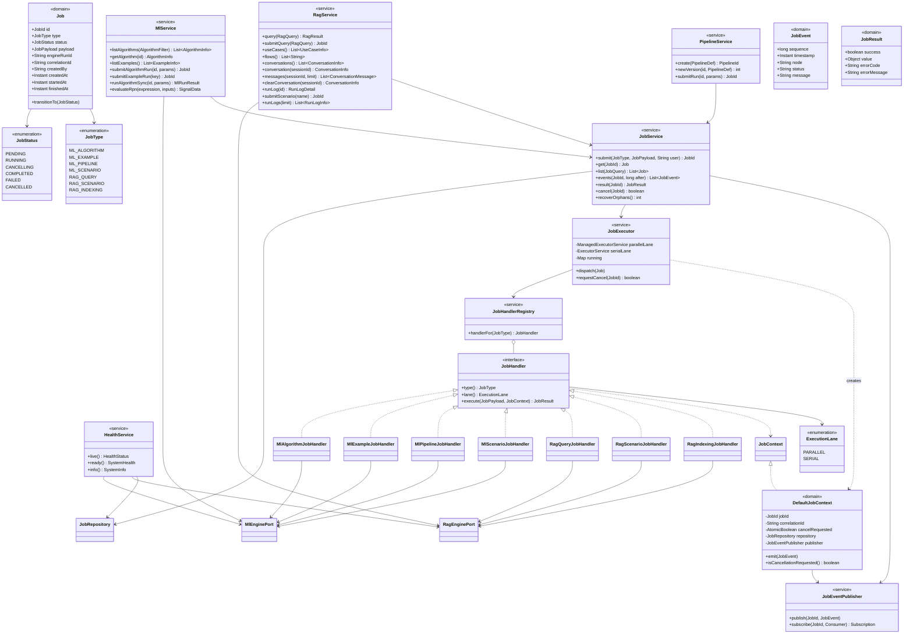

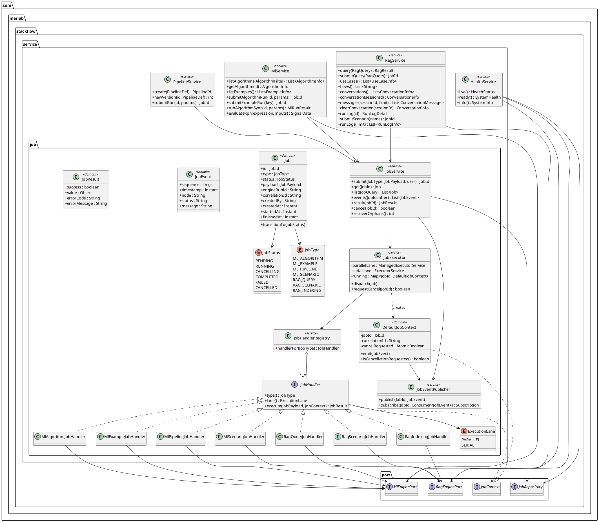

**Carril por handler**

| Handler | Carril | Motivo |
|---|---|---|
| `MlExampleJobHandler` | SERIAL | `ExampleRunner.run()` captura `System.out` (global) |
| `MlAlgorithmJobHandler` | SERIAL | usa la misma ruta que los ejemplos |
| `MlPipelineJobHandler`, `MlScenarioJobHandler` | PARALLEL | llaman directamente a las clases de MerLabCore |
| `RagQueryJobHandler`, `RagScenarioJobHandler` | PARALLEL o SERIAL | depende de la prueba de concurrencia de Pegasus (riesgo abierto) |
| `RagIndexingJobHandler` | SERIAL | escribe en los índices |

---

### 3.4 Ports y modelo de dominio

**Qué muestra:** las **interfaces** que separan StackFlow de las librerías y los records de dominio que viajan por ellas. Los servicios solo conocen esto, nunca `pegasus.*` ni `com.merlab.signals.*`. Si mañana cambias el motor RAG, solo cambia el adaptador.

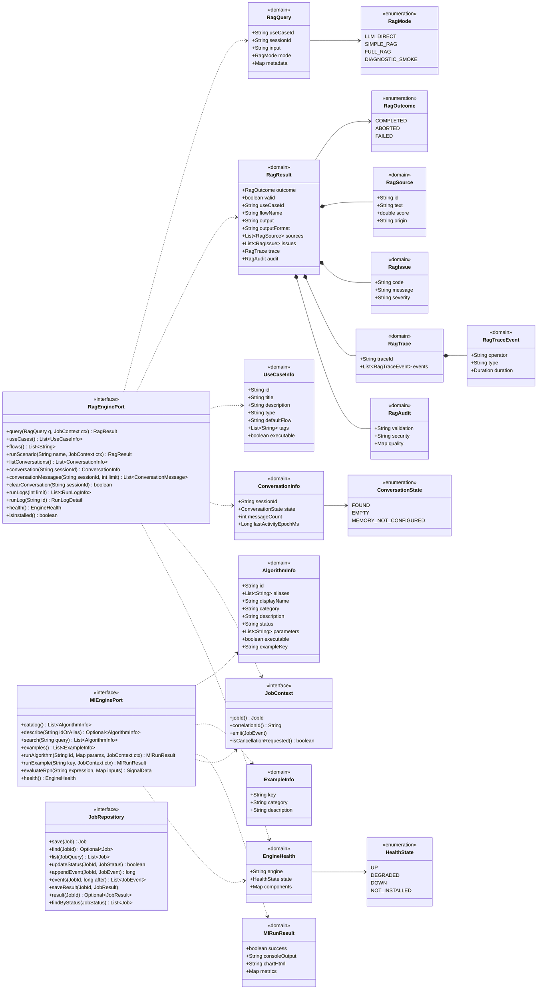

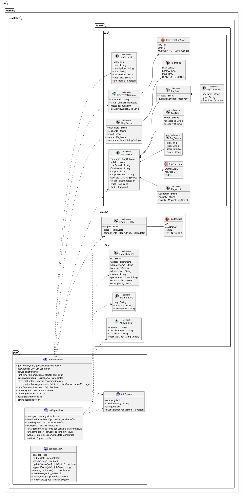

**Notas**
- `RagMode` copia los valores de `pegasus.runtime.flowgraph.OrchestrationMode` sin importarlo. El adaptador convierte con `OrchestrationMode.fromId()`. La decisión O1 (alias `SIMPLE` / `GRAPH`) se resolvería aquí, en `ApiMapper.toRagQuery`.
- `RagOutcome` refleja `pegasus.runtime.pipeline.PipelineStatus` (`COMPLETED`, `ABORTED`, `FAILED`). La conversión a HTTP está en 4.2 y 7.2.

---

### 3.5 Adaptador MerLabCore

**Qué muestra:** cómo `MerLabCoreEngineAdapter` implementa `MlEnginePort` usando **solo clases existentes** de MerLabCore:
- `AlgorithmCatalog.defaultCatalog()` y `AlgorithmDescriptor` para el catálogo (solo lectura);
- `ExampleRunner.run(key)` para ejecutar ejemplos y algoritmos (la misma ruta que usa el comando `run algorithm` del miniserver);
- `SignalStack` / el paquete `rpn` para `/stack/evaluate`.

Ninguna de estas clases se modifica, y el miniserver no se arranca.

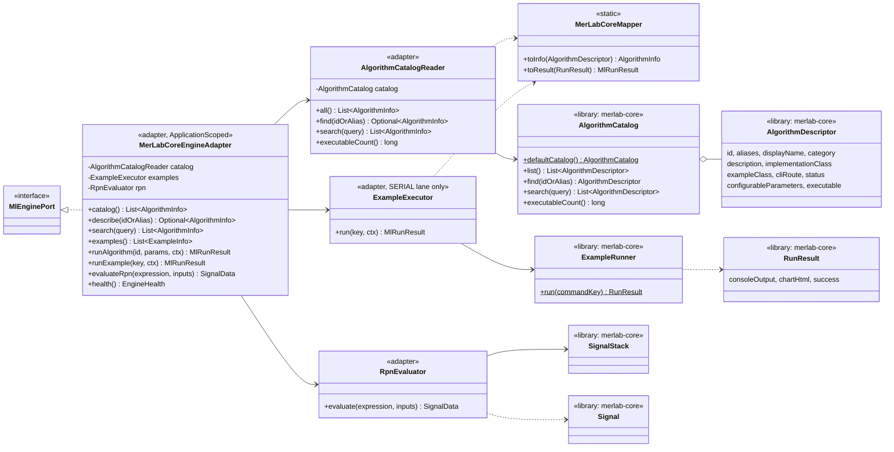

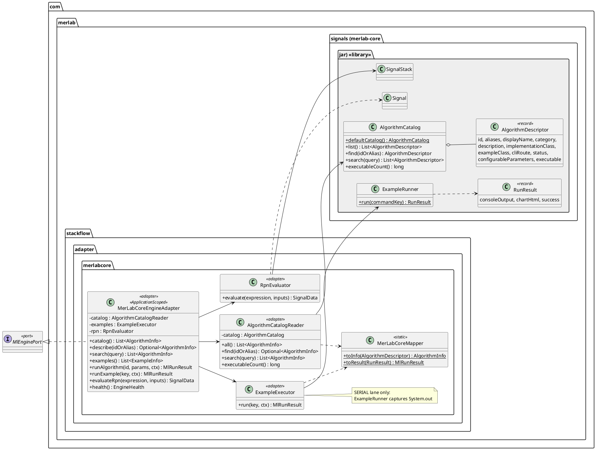

**Notas**
- `AlgorithmCatalog`, `ExampleRunner` y `AlgorithmDescriptor` están en el paquete `com.merlab.signals.miniserver`. Usarlos como clases **no** arranca ni modifica el miniserver. Si algún día prefieres no depender de ese paquete, solo cambia `AlgorithmCatalogReader`.
- `runAlgorithm(id)` hace `describe(id)`, toma `exampleClass` / `cliRoute` del descriptor y llama a `ExampleRunner.run(...)`. Si el descriptor dice `executable=false`, se responde `409 ALGORITHM_NOT_EXECUTABLE`.
- `ExampleExecutor` comprueba `ctx.isCancellationRequested()` antes de empezar. Una vez dentro de `ExampleRunner.run` no se puede cortar, así que la cancelación solo es efectiva mientras el job está en `PENDING`.

---

### 3.6 Adaptador MerLabRAG

**Qué muestra:** cómo se arranca y usa Pegasus dentro de WildFly **sin cambiar MerLabRAG**.

1. **`PegasusRuntimeProducer`** (CDI `@ApplicationScoped`, al arrancar). Hace lo mismo que hacen hoy `DevAppRuntimeFactory` y `MiniServerRunner` en desarrollo:
   - crea los adaptadores de la librería (`OllamaLlmAdapter`, Qdrant/pgvector…) con la configuración de WildFly (`PegasusServerConfig`);
   - registra los ports de StackFlow (`StackflowObservabilityBridge`, `StackflowAuditSink`) con `bindPort`;
   - monta el runtime con `RagApplicationBuilder` y registra los flows;
   - carga los perfiles de casos de uso (`FileYamlUseCaseProfileRegistry` o `PostgresJsonbUseCaseProfileRegistry`) y construye `UseCaseRegistry.of(...)`;
   - **produce** `PegasusRuntime`, `PegasusEngine`, `UseCaseRegistry` y `MemoryPort` para inyectarlos.
2. **`RagUseCaseDispatcher`**: dado un `useCaseId`, elige **quién** lo ejecuta:
   - si el caso tiene un executor propio registrado, ese executor (envuelve tu `*Runner`);
   - si no, `FlowUseCaseExecutor`, que llama a `PegasusEngine.run()` con el `defaultFlow` del `UseCaseDefinition`.
3. **`UseCaseExecutor`** es una interfaz **de StackFlow** con una implementación por familia de Runner. Los Runners son clases públicas de MerLabRAG y se usan tal cual.
4. **`StackflowObservabilityBridge`** implementa el `ObservabilityPort` de Pegasus y reenvía cada `OperatorEvent` al `JobContext` del job en curso. Así se ven los eventos en `/jobs/{id}/events`.

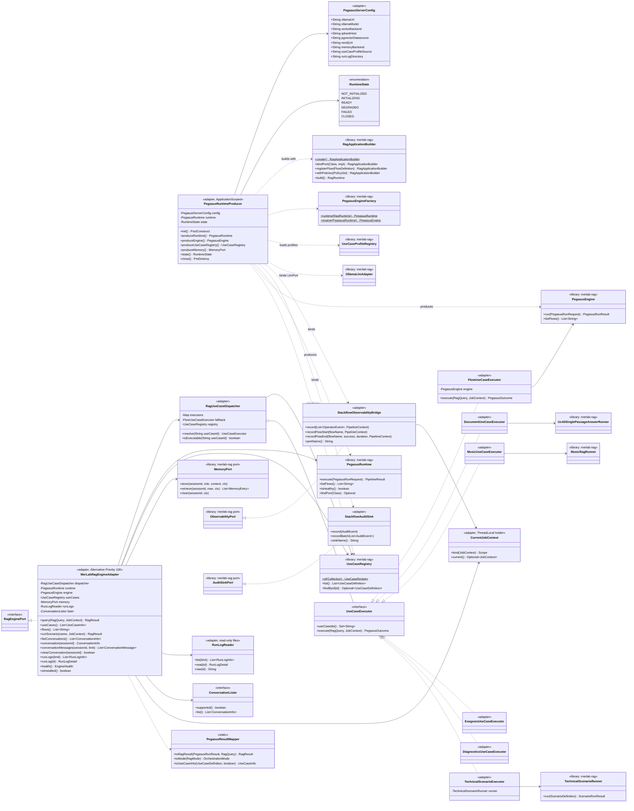

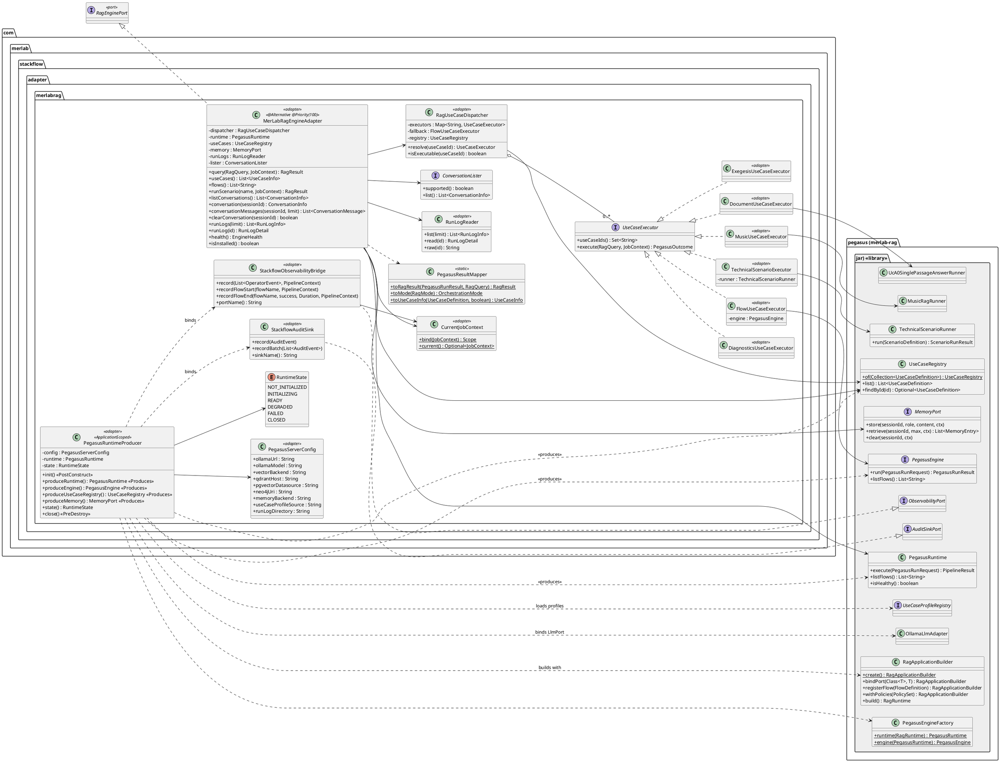

**Notas**
- `PegasusOutcome` es un record interno del adaptador. Junta lo que devuelven los distintos Runners (`PegasusRunResult`, `MusicRagRunResult`, `UcA0RetrievalAnswerResult`…) para que `PegasusResultMapper` produzca siempre un `RagResult`.
- Las clases `DocumentUseCaseExecutor`, `ExegesisUseCaseExecutor`… son **una por familia** de casos de uso, no una por Runner. Cada una declara en `useCaseIds()` qué ids atiende. Un caso de uso sin executor se ejecuta por su `defaultFlow`.
- `CurrentJobContext` es necesario porque `ObservabilityPort` recibe un `PipelineContext` de Pegasus, no el `JobContext` de StackFlow. El adaptador hace `bind(ctx)` antes de ejecutar y lo suelta al terminar (try-with-resources).
- `RunLogReader` solo **lee** el directorio de logs. Si los logs los escribe el miniserver en desarrollo, en el servidor ese directorio lo llena `StackflowAuditSink`.

---

### 3.7 Persistencia

**Qué muestra:** las dos entidades nuevas del sistema de jobs y su repositorio. `JobEntity` reutiliza y amplía la tabla `job_queue` que ya tienes. `JobEventEntity` es la tabla nueva `job_events`. `JpaJobRepository` implementa el port `JobRepository`, y el servicio nunca ve JPA.

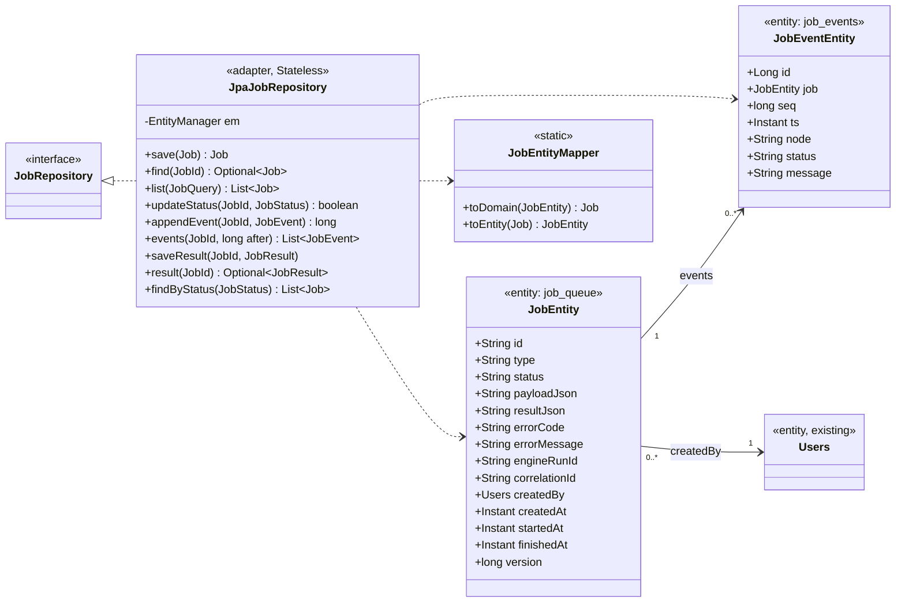

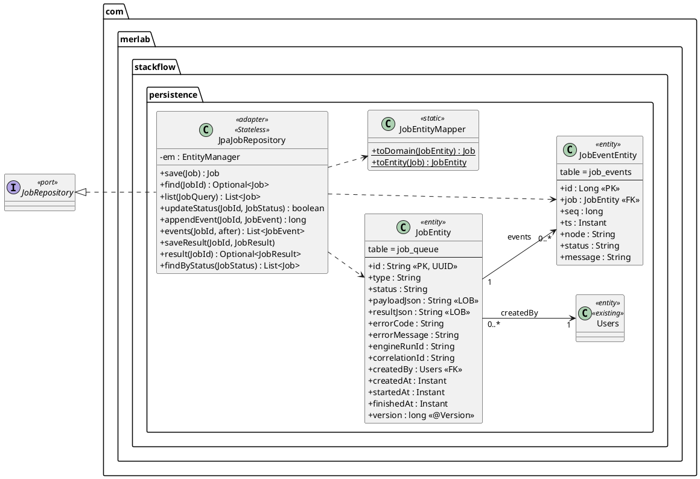

**Notas**
- `@Version` en `JobEntity` evita que dos hilos cambien el estado a la vez (por ejemplo, el ejecutor marca `COMPLETED` justo cuando llega un `DELETE`). `updateStatus` solo aplica transiciones válidas (ver 4.1).
- `appendEvent` asigna `seq` de forma creciente por job. Así `GET /jobs/{id}/events?after=N` es un `WHERE seq > N`.

---

### 3.8 Errores

**Qué muestra:** una sola jerarquía de excepciones y un solo mapper. Sustituye a los 4 mappers actuales. Cada excepción lleva su `ErrorCode`, y el código sabe su estado HTTP. `ErrorDetailPolicy` decide cuánto detalle se muestra: sin stacktrace en producción, con más detalle en el perfil `dev`.

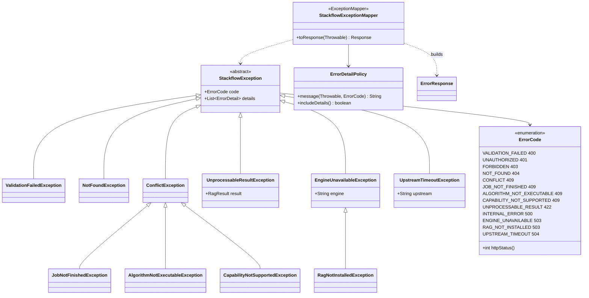

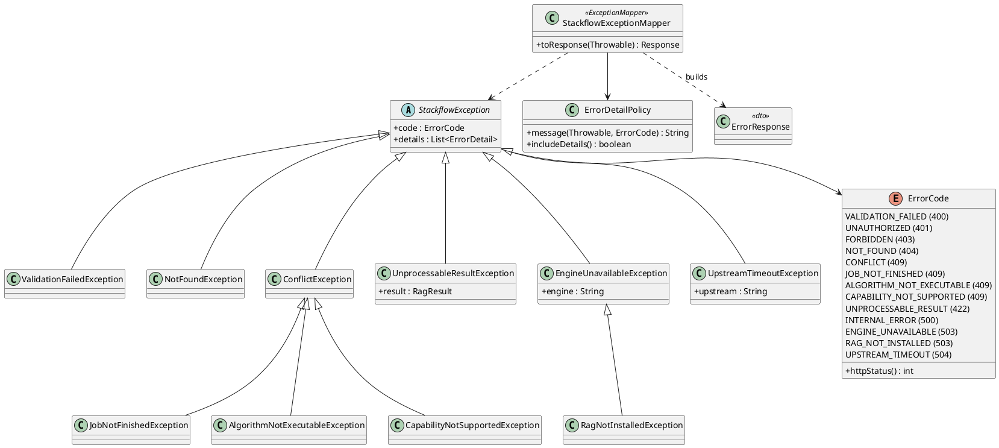

**Nota:** `UnprocessableResultException` es especial. El cuerpo de la respuesta `422` no es un `ErrorResponse`, sino el `QueryResponse` completo con `valid=false`, igual que en el contrato de la empresa. Así el cliente ve qué salió mal (fuentes, errores, auditoría).

---

### 3.9 Conversaciones y logs completos (4 endpoints añadidos)

**Qué muestra:** las clases de los 4 endpoints añadidos al final del diseño:

| # | Endpoint | Clase y método |
|---|---|---|
| 1 | `GET /rag/conversations` | `RagConversationResource.list()` |
| 2 | `GET /rag/conversations/{sessionId}/messages` | `RagConversationResource.messages()` |
| 3 | `DELETE /rag/conversations/{sessionId}` | `RagConversationResource.delete()` |
| 4 | `GET /rag/run-logs/{id}` | `RagRunLogResource.get()` |

- **Leer (2) y borrar (3)** usan el `MemoryPort` de tu RAG tal cual (`retrieve` y `clear`).
- **Listar (1)** no existe en `MemoryPort`. Por eso StackFlow define su propia interfaz `ConversationLister`, con dos implementaciones:
  - `RedisConversationLister` recorre las claves de sesión en Redis con `SCAN` (nunca con `KEYS`, que bloquea Redis) y para cada una pide el resumen;
  - `UnsupportedConversationLister` se usa con memoria en RAM: `supported()` devuelve `false` y el endpoint responde `409 CAPABILITY_NOT_SUPPORTED`.

  `PegasusRuntimeProducer` elige una u otra según `memoryBackend`.
- **Log completo (4)**: `RunLogReader.read(id)` devuelve `RunLogDetail` con todas las entradas. `/raw` sigue existiendo para el texto sin procesar.

```mermaid
classDiagram
    direction LR

    class RagConversationResource {
        <<resource>>
        +list() ConversationListResponse
        +get(sessionId) ConversationResponse
        +messages(sessionId, limit) ConversationMessagesResponse
        +delete(sessionId) ConversationResponse
    }
    class RagRunLogResource {
        <<resource>>
        +list(limit) RunLogListResponse
        +get(id) RunLogResponse
        +raw(id) String
        +analysis(id) RunLogAnalysisResponse
    }

    class ConversationListResponse {
        <<dto>>
        +boolean memoryConfigured
        +int total
        +List~ConversationResponse~ items
    }
    class ConversationMessagesResponse {
        <<dto>>
        +String sessionId
        +int total
        +List~ConversationMessageResponse~ messages
    }
    class ConversationMessageResponse {
        <<dto>>
        +int index
        +String role
        +String content
        +Long createdAtEpochMs
    }
    class RunLogResponse {
        <<dto>>
        +String id
        +String flowName
        +String useCaseId
        +String status
        +String startedAt
        +long durationMs
        +List~RunLogEntryResponse~ entries
    }
    class RunLogEntryResponse {
        <<dto>>
        +long seq
        +String timestamp
        +String level
        +String operator
        +String message
    }

    class RagService {
        <<service>>
        +conversations() List~ConversationInfo~
        +messages(sessionId, limit) List~ConversationMessage~
        +clearConversation(sessionId) ConversationInfo
        +runLog(id) RunLogDetail
    }
    class RagEnginePort {
        <<interface>>
        +listConversations() List~ConversationInfo~
        +conversationMessages(sessionId, limit) List~ConversationMessage~
        +clearConversation(sessionId) boolean
        +runLog(id) RunLogDetail
    }
    class ConversationMessage {
        <<domain>>
        +int index
        +String role
        +String content
        +Long createdAtEpochMs
    }
    class RunLogDetail {
        <<domain>>
        +RunLogInfo info
        +List~RunLogEntry~ entries
    }
    class RunLogEntry {
        <<domain>>
        +long seq
        +Instant timestamp
        +String level
        +String operator
        +String message
    }

    class MerLabRagEngineAdapter {
        <<adapter>>
        -MemoryPort memory
        -ConversationLister lister
        -RunLogReader runLogs
    }
    class ConversationLister {
        <<interface>>
        +supported() boolean
        +list() List~ConversationInfo~
    }
    class RedisConversationLister {
        <<adapter>>
        -RedisMemoryConfig config
        -String keyPrefix
        +supported() boolean
        +list() List~ConversationInfo~
    }
    class UnsupportedConversationLister {
        <<adapter>>
        +supported() boolean
        +list() List~ConversationInfo~
    }
    class RunLogReader {
        <<adapter, read-only files>>
        +list(limit) List~RunLogInfo~
        +read(id) RunLogDetail
        +raw(id) String
    }
    class MemoryPort {
        <<library: merlab-rag port>>
        +retrieve(sessionId, max, ctx) List~MemoryEntry~
        +clear(sessionId, ctx)
    }
    class MemoryEntry {
        <<library: merlab-rag>>
    }
    class RedisMemoryConfig {
        <<library: merlab-rag>>
    }

    RagConversationResource --> RagService
    RagRunLogResource --> RagService
    RagConversationResource ..> ConversationListResponse
    RagConversationResource ..> ConversationMessagesResponse
    RagRunLogResource ..> RunLogResponse
    ConversationMessagesResponse *-- ConversationMessageResponse
    RunLogResponse *-- RunLogEntryResponse
    RagService --> RagEnginePort
    RagEnginePort ..> ConversationMessage
    RagEnginePort ..> RunLogDetail
    RunLogDetail *-- RunLogEntry
    RagEnginePort <|.. MerLabRagEngineAdapter
    MerLabRagEngineAdapter --> MemoryPort : retrieve, clear
    MerLabRagEngineAdapter --> ConversationLister : list
    MerLabRagEngineAdapter --> RunLogReader : read
    ConversationLister <|.. RedisConversationLister
    ConversationLister <|.. UnsupportedConversationLister
    RedisConversationLister ..> RedisMemoryConfig : same host and prefix
    MemoryPort ..> MemoryEntry
```

```plantuml
@startuml conversations-logs
left to right direction
skinparam classAttributeIconSize 0

package "web" {
  class RagConversationResource <<resource>> {
    +list() : ConversationListResponse
    +get(sessionId) : ConversationResponse
    +messages(sessionId, limit) : ConversationMessagesResponse
    +delete(sessionId) : ConversationResponse
  }
  class RagRunLogResource <<resource>> {
    +list(limit) : RunLogListResponse
    +get(id) : RunLogResponse
    +raw(id) : String
    +analysis(id) : RunLogAnalysisResponse
  }
}

package "api" {
  class ConversationListResponse <<dto>> {
    +memoryConfigured : boolean
    +total : int
    +items : List<ConversationResponse>
  }
  class ConversationMessagesResponse <<dto>> {
    +sessionId : String
    +total : int
    +messages : List<ConversationMessageResponse>
  }
  class ConversationMessageResponse <<dto>> {
    +index : int
    +role : String
    +content : String
    +createdAtEpochMs : Long
  }
  class RunLogResponse <<dto>> {
    +id : String
    +flowName : String
    +useCaseId : String
    +status : String
    +startedAt : String
    +durationMs : long
    +entries : List<RunLogEntryResponse>
  }
  class RunLogEntryResponse <<dto>> {
    +seq : long
    +timestamp : String
    +level : String
    +operator : String
    +message : String
  }
}

package "service / port / domain" {
  class RagService <<service>> {
    +conversations() : List<ConversationInfo>
    +messages(sessionId, limit) : List<ConversationMessage>
    +clearConversation(sessionId) : ConversationInfo
    +runLog(id) : RunLogDetail
  }
  interface RagEnginePort {
    +listConversations() : List<ConversationInfo>
    +conversationMessages(sessionId, limit) : List<ConversationMessage>
    +clearConversation(sessionId) : boolean
    +runLog(id) : RunLogDetail
  }
  class ConversationMessage <<domain>> {
    +index : int
    +role : String
    +content : String
    +createdAtEpochMs : Long
  }
  class RunLogDetail <<domain>> {
    +info : RunLogInfo
    +entries : List<RunLogEntry>
  }
  class RunLogEntry <<domain>> {
    +seq : long
    +timestamp : Instant
    +level : String
    +operator : String
    +message : String
  }
}

package "adapter.merlabrag" {
  class MerLabRagEngineAdapter <<adapter>> {
    -memory : MemoryPort
    -lister : ConversationLister
    -runLogs : RunLogReader
  }
  interface ConversationLister {
    +supported() : boolean
    +list() : List<ConversationInfo>
  }
  class RedisConversationLister <<adapter>> {
    -config : RedisMemoryConfig
    -keyPrefix : String
    +supported() : boolean
    +list() : List<ConversationInfo>
  }
  class UnsupportedConversationLister <<adapter>> {
    +supported() : boolean
    +list() : List<ConversationInfo>
  }
  class RunLogReader <<adapter>> {
    +list(limit) : List<RunLogInfo>
    +read(id) : RunLogDetail
    +raw(id) : String
  }
}

package "pegasus (merlab-rag.jar) <<library>>" #EEEEEE {
  interface MemoryPort {
    +retrieve(sessionId, max, ctx) : List<MemoryEntry>
    +clear(sessionId, ctx)
  }
  class MemoryEntry
  class RedisMemoryConfig
}

RagConversationResource --> RagService
RagRunLogResource --> RagService
RagConversationResource ..> ConversationListResponse
RagConversationResource ..> ConversationMessagesResponse
RagRunLogResource ..> RunLogResponse
ConversationMessagesResponse *-- ConversationMessageResponse
RunLogResponse *-- RunLogEntryResponse
RagService --> RagEnginePort
RagEnginePort ..> ConversationMessage
RagEnginePort ..> RunLogDetail
RunLogDetail *-- RunLogEntry
RagEnginePort <|.. MerLabRagEngineAdapter
MerLabRagEngineAdapter --> MemoryPort : retrieve, clear
MerLabRagEngineAdapter --> ConversationLister : list
MerLabRagEngineAdapter --> RunLogReader : read
ConversationLister <|.. RedisConversationLister
ConversationLister <|.. UnsupportedConversationLister
RedisConversationLister ..> RedisMemoryConfig : same host / prefix
MemoryPort ..> MemoryEntry
@enduml
```

**Secuencia: listar, leer y borrar conversaciones.** Primero se pide la lista; con un `sessionId` de la lista se leen sus mensajes, y si se quiere se borra.

```mermaid
sequenceDiagram
    autonumber
    actor C as Client
    participant R as RagConversationResource
    participant S as RagService
    participant A as MerLabRagEngineAdapter
    participant L as ConversationLister
    participant M as MemoryPort
    participant Redis as Redis

    C->>R: GET /rag/conversations
    R->>S: conversations()
    S->>A: listConversations()
    A->>L: supported()
    alt in-memory backend
        L-->>A: false
        A--)S: CapabilityNotSupportedException
        R-->>C: 409 CAPABILITY_NOT_SUPPORTED
    else Redis backend
        L-->>A: true
        A->>L: list()
        loop SCAN cursor
            L->>Redis: SCAN cursor MATCH prefix*
            Redis-->>L: session keys
        end
        L-->>A: List of ConversationInfo
        A-->>S: list
        R-->>C: 200 ConversationListResponse
    end

    C->>R: GET /rag/conversations/s-123/messages?limit=50
    R->>S: messages("s-123", 50)
    S->>A: conversationMessages("s-123", 50)
    A->>M: retrieve("s-123", 50, ctx)
    M-->>A: List of MemoryEntry
    A-->>S: List of ConversationMessage
    R-->>C: 200 ConversationMessagesResponse

    C->>R: DELETE /rag/conversations/s-123
    R->>S: clearConversation("s-123")
    S->>A: clearConversation("s-123")
    A->>M: clear("s-123", ctx)
    R-->>C: 200 ConversationResponse(state=EMPTY)
```

```plantuml
@startuml seq-conversations
autonumber
actor Client as C
participant RagConversationResource as R
participant RagService as S
participant MerLabRagEngineAdapter as A
participant ConversationLister as L
participant "MemoryPort\n<<library>>" as M
database Redis

C -> R : GET /rag/conversations
R -> S : conversations()
S -> A : listConversations()
A -> L : supported()
alt in-memory backend
  L --> A : false
  A --> S : CapabilityNotSupportedException
  R --> C : 409 CAPABILITY_NOT_SUPPORTED
else Redis backend
  L --> A : true
  A -> L : list()
  loop SCAN cursor
    L -> Redis : SCAN cursor MATCH prefix*
    Redis --> L : session keys
  end
  L --> A : List<ConversationInfo>
  A --> S : list
  R --> C : 200 ConversationListResponse
end

C -> R : GET /rag/conversations/s-123/messages?limit=50
R -> S : messages("s-123", 50)
S -> A : conversationMessages("s-123", 50)
A -> M : retrieve("s-123", 50, ctx)
M --> A : List<MemoryEntry>
A --> S : List<ConversationMessage>
R --> C : 200 ConversationMessagesResponse

C -> R : DELETE /rag/conversations/s-123
R -> S : clearConversation("s-123")
S -> A : clearConversation("s-123")
A -> M : clear("s-123", ctx)
R --> C : 200 ConversationResponse(state=EMPTY)
@enduml
```

**Notas**
- `RedisConversationLister` necesita conocer el **prefijo de las claves** que usa `RedisConversationMemory`. Se lee de la misma configuración (`RedisMemoryConfig`) para no duplicarlo. Si tu librería no expone el prefijo, se pone en la configuración de StackFlow con el mismo valor.
- `messages` tiene `limit` (por defecto 100, máximo 1000) para no traer conversaciones enormes de una vez.
- Roles: listar y leer con `AUDITOR`, borrar con `ADMIN`. Las conversaciones pueden contener datos personales.

---

### 3.10 Modo sin RAG (MerLabRAG opcional)

**Qué muestra:** cómo StackFlow funciona **solo con MerLabCore** cuando la librería MerLabRAG no está instalada en Maven. Hay dos niveles.

**1. Compilación.** El módulo `stackflow-adapter-merlabrag` solo entra en el build con el perfil Maven `rag`. El perfil se activa solo si existe el JAR de MerLabRAG en `~/.m2`. Sin él, el WAR se genera sin el adaptador, sin Pegasus y sin sus dependencias (Qdrant, Neo4j, Jedis…).

```mermaid
flowchart LR
    subgraph ALWAYS["Always built"]
        API["stackflow-api"]
        SVC["stackflow-service<br/>RagEnginePort<br/>UnavailableRagEngine (default)"]
        AMC["stackflow-adapter-merlabcore"]
        PER["stackflow-persistence"]
        WEB["stackflow-web (war)"]
    end
    subgraph OPT["Only with Maven profile rag<br/>(auto: merlab-rag jar exists in ~/.m2)"]
        ARG["stackflow-adapter-merlabrag<br/>MerLabRagEngineAdapter<br/>Alternative, Priority 100"]
        LIBR[["merlab-rag.jar"]]
    end
    LIBC[["merlab-core.jar (mandatory)"]]

    WEB --> API
    WEB --> SVC
    WEB --> AMC
    WEB --> PER
    AMC --> SVC
    PER --> SVC
    AMC --> LIBC
    WEB -. "profile rag" .-> ARG
    ARG --> SVC
    ARG --> LIBR
```

```plantuml
@startuml build-profiles
left to right direction
package "Always built" {
  package "stackflow-api" as API
  package "stackflow-service\n(RagEnginePort,\nUnavailableRagEngine default)" as SVC
  package "stackflow-adapter-merlabcore" as AMC
  package "stackflow-persistence" as PER
  package "stackflow-web (war)" as WEB
}
package "Only with Maven profile rag\n(auto: merlab-rag jar in ~/.m2)" #FFF8DC {
  package "stackflow-adapter-merlabrag\n(MerLabRagEngineAdapter\n@Alternative @Priority(100))" as ARG
  package "merlab-rag.jar" as LIBR
}
package "merlab-core.jar (mandatory)" as LIBC

WEB ..> API
WEB ..> SVC
WEB ..> AMC
WEB ..> PER
AMC ..> SVC
PER ..> SVC
AMC ..> LIBC
WEB ..> ARG : profile rag
ARG ..> SVC
ARG ..> LIBR
@enduml
```

**2. Ejecución.** `RagEnginePort` siempre tiene una implementación:
- **sin el módulo RAG:** `UnavailableRagEngine` (en `stackflow-service`). `health()` devuelve `NOT_INSTALLED` y el resto de métodos lanzan `RagNotInstalledException` (`503`, código `RAG_NOT_INSTALLED`);
- **con el módulo RAG:** `MerLabRagEngineAdapter`, marcado `@Alternative @Priority(100)`. CDI lo prefiere automáticamente.

`RagService`, los handlers RAG y los recursos `/rag/*` no cambian: no saben qué implementación tienen detrás. `JobService` comprueba antes de crear un job `RAG_*` que el motor esté instalado, para no dejar jobs `FAILED` inútiles en la base de datos.

```mermaid
classDiagram
    direction LR

    class RagEnginePort {
        <<interface>>
        +query(RagQuery, JobContext) RagResult
        +listConversations() List~ConversationInfo~
        +runLog(id) RunLogDetail
        +health() EngineHealth
        +isInstalled() boolean
    }
    class UnavailableRagEngine {
        <<service, ApplicationScoped, default>>
        +query(RagQuery, JobContext) RagResult
        +health() EngineHealth
        +isInstalled() boolean
    }
    class MerLabRagEngineAdapter {
        <<adapter, Alternative Priority 100>>
        +isInstalled() boolean
    }
    class RagNotInstalledException {
        +ErrorCode code = RAG_NOT_INSTALLED
    }
    class EngineUnavailableException
    class RagService {
        <<service>>
    }
    class JobService {
        <<service>>
        +submit(JobType, JobPayload, user) JobId
        -requireEngine(JobType)
    }
    class HealthService {
        <<service>>
        +ready() SystemHealth
        +info() SystemInfo
    }
    class HealthState {
        <<enumeration>>
        UP
        DEGRADED
        DOWN
        NOT_INSTALLED
    }

    RagEnginePort <|.. UnavailableRagEngine : without profile rag
    RagEnginePort <|.. MerLabRagEngineAdapter : with profile rag
    EngineUnavailableException <|-- RagNotInstalledException
    UnavailableRagEngine ..> RagNotInstalledException : throws
    RagService --> RagEnginePort
    JobService --> RagEnginePort : isInstalled()
    HealthService --> RagEnginePort : health()
    UnavailableRagEngine ..> HealthState : NOT_INSTALLED
```

```plantuml
@startuml no-rag-classes
left to right direction
skinparam classAttributeIconSize 0

interface RagEnginePort {
  +query(RagQuery, JobContext) : RagResult
  +listConversations() : List<ConversationInfo>
  +runLog(id) : RunLogDetail
  +health() : EngineHealth
  +isInstalled() : boolean
}
class UnavailableRagEngine <<service>> <<ApplicationScoped>> <<default>> {
  +query(RagQuery, JobContext) : RagResult
  +health() : EngineHealth
  +isInstalled() : boolean
}
note bottom of UnavailableRagEngine
  every method except health()/isInstalled()
  throws RagNotInstalledException
end note
class MerLabRagEngineAdapter <<adapter>> <<@Alternative @Priority(100)>> {
  +isInstalled() : boolean
}
class EngineUnavailableException
class RagNotInstalledException {
  +code : ErrorCode = RAG_NOT_INSTALLED
}
class RagService <<service>>
class JobService <<service>> {
  +submit(JobType, JobPayload, user) : JobId
  -requireEngine(JobType)
}
class HealthService <<service>> {
  +ready() : SystemHealth
  +info() : SystemInfo
}
enum HealthState {
  UP
  DEGRADED
  DOWN
  NOT_INSTALLED
}

RagEnginePort <|.. UnavailableRagEngine : without profile rag
RagEnginePort <|.. MerLabRagEngineAdapter : with profile rag
EngineUnavailableException <|-- RagNotInstalledException
UnavailableRagEngine ..> RagNotInstalledException : throws
RagService --> RagEnginePort
JobService --> RagEnginePort : isInstalled()
HealthService --> RagEnginePort : health()
UnavailableRagEngine ..> HealthState : NOT_INSTALLED
@enduml
```

**Qué responde cada parte sin MerLabRAG**

| Parte | Respuesta |
|---|---|
| `/ml/*`, `/stack`, `/pipelines`, `/scenarios`, `/signals`, `/users`, jobs `ML_*` | normal |
| `/rag/*` (13 endpoints) | `503 ErrorResponse(RAG_NOT_INSTALLED)` |
| `POST /jobs` con tipo `RAG_*` | `503 RAG_NOT_INSTALLED`, sin crear job |
| `/health/ready` | `200 UP`; componente `merlabrag: NOT_INSTALLED`, que **no** cuenta como fallo |
| `/info` | `engines.merlabrag = "NOT_INSTALLED"`; FlowScope puede ocultar la parte de RAG |

**Protecciones:** reglas ArchUnit (`service` y `web` no importan `pegasus..`), más un build de prueba con `-P!rag` que comprueba que la parte ML funciona y que `/rag/query` responde `503 RAG_NOT_INSTALLED`.

---

## 4. Diagramas de estado

### 4.1 Ciclo de vida de un job

**Qué muestra:** los estados por los que pasa cualquier job (ML o RAG) y qué los provoca.

| Estado | Significado |
|---|---|
| `PENDING` | guardado en `job_queue`, esperando hilo |
| `RUNNING` | un handler lo está ejecutando. Se guarda `startedAt` y, si lo hay, `engineRunId` |
| `CANCELLING` | llegó `DELETE /jobs/{id}` mientras corría. El handler lo verá en el siguiente `isCancellationRequested()` |
| `COMPLETED`, `FAILED`, `CANCELLED` | **finales**: no se puede salir de ellos y tienen `finishedAt` |

Transiciones especiales:
- **Timeout:** si supera `job.timeout.<type>` pasa a `FAILED` con `UPSTREAM_TIMEOUT`.
- **Reinicio del servidor:** al arrancar, `JobService.recoverOrphans()` marca como `FAILED` (`code=SERVER_RESTART`) los jobs que quedaron en `RUNNING` o `CANCELLING`.
- `GET /jobs/{id}/result` solo devuelve `200` en estados finales. En los demás devuelve `409 JOB_NOT_FINISHED`.

```mermaid
stateDiagram-v2
    [*] --> PENDING : POST /jobs or 202 from a run endpoint

    PENDING --> RUNNING : executor picks job (startedAt)
    PENDING --> CANCELLED : DELETE /jobs/id

    RUNNING --> COMPLETED : handler returns success
    RUNNING --> FAILED : handler throws or success=false
    RUNNING --> FAILED : timeout (UPSTREAM_TIMEOUT)
    RUNNING --> CANCELLING : DELETE /jobs/id

    CANCELLING --> CANCELLED : handler sees cancellation
    CANCELLING --> COMPLETED : handler finished before checking
    CANCELLING --> FAILED : handler failed before checking

    RUNNING --> FAILED : server restart (recoverOrphans)
    CANCELLING --> FAILED : server restart (recoverOrphans)

    COMPLETED --> [*]
    FAILED --> [*]
    CANCELLED --> [*]

    note right of CANCELLING
        Non-interruptible work (ExampleRunner)
        always ends in COMPLETED or FAILED
    end note
```

```plantuml
@startuml job-lifecycle
hide empty description
[*] --> PENDING : POST /jobs\nor 202 from a run endpoint

PENDING --> RUNNING : executor picks job\n(startedAt)
PENDING --> CANCELLED : DELETE /jobs/{id}

RUNNING --> COMPLETED : handler returns success
RUNNING --> FAILED : handler throws\nor success=false
RUNNING --> FAILED : timeout\n(UPSTREAM_TIMEOUT)
RUNNING --> CANCELLING : DELETE /jobs/{id}

CANCELLING --> CANCELLED : handler sees cancellation
CANCELLING --> COMPLETED : finished before checking
CANCELLING --> FAILED : failed before checking

RUNNING --> FAILED : server restart\n(recoverOrphans)
CANCELLING --> FAILED : server restart\n(recoverOrphans)

COMPLETED --> [*]
FAILED --> [*]
CANCELLED --> [*]

state COMPLETED #palegreen
state FAILED #mistyrose
state CANCELLED #lightgrey

note right of CANCELLING
  Non-interruptible work (ExampleRunner)
  always ends in COMPLETED or FAILED
end note
@enduml
```

**Tabla de transiciones válidas** (la aplica `Job.transitionTo` y `JpaJobRepository.updateStatus`)

| Desde \ Hacia | RUNNING | CANCELLING | COMPLETED | FAILED | CANCELLED |
|---|---|---|---|---|---|
| PENDING | ✔ | – | – | – | ✔ |
| RUNNING | – | ✔ | ✔ | ✔ | – |
| CANCELLING | – | – | ✔ | ✔ | ✔ |
| COMPLETED / FAILED / CANCELLED | – | – | – | – | – |

Cualquier otra transición lanza `ConflictException` (`409`).

---

### 4.2 Ejecución de una consulta RAG en Pegasus y su resultado HTTP

**Qué muestra:** qué pasa **dentro** de Pegasus durante un flow (`FULL_RAG` como ejemplo) y cómo cada final se convierte en la respuesta REST.

Pasos del flow:
1. **Security check.** `SecurityStatus` pasa de `PENDING` a `PASSED` o `BLOCKED`. Si es `BLOCKED`, el flow se aborta.
2. **Retrieval.** Recuperación híbrida (vector + BM25 + grafo, fusionados con `ReciprocalRankFusion`). Si `RetrievalHealthCheck` dice que el contexto es pobre, `RetrievalRepairStrategy` reintenta (*healing*) hasta un máximo de visitas (`MaxNodeVisitsFlowCondition`).
3. **Generation.** Llamada al LLM (Ollama). `GenerationHealthCheck` puede pedir reparación (*healing*) de la misma forma.
4. **Validation.** `ValidationStatus` pasa de `PENDING` a `PASSED` o `FAILED`.

Al final, Pegasus devuelve `PipelineStatus` (`COMPLETED`, `ABORTED` o `FAILED`) y StackFlow lo convierte así:

| Final en Pegasus | `RagOutcome` | `success` | `valid` | HTTP |
|---|---|---|---|---|
| COMPLETED + validation PASSED | COMPLETED | true | true | **200** |
| COMPLETED + validation FAILED | COMPLETED | true | false | **422** (cuerpo = QueryResponse) |
| ABORTED (security BLOCKED, guardrail, límite de healing) | ABORTED | false | false | **422** (cuerpo = QueryResponse) |
| FAILED por error del motor | FAILED | false | false | **500** `INTERNAL_ERROR` |
| FAILED por Ollama, Qdrant… caído o lento | FAILED | – | – | **503** `ENGINE_UNAVAILABLE` / **504** `UPSTREAM_TIMEOUT` |

En modo asíncrono, los casos 200 y 422 dejan el job en `COMPLETED` (el resultado está en `/result`), y los casos 500/503/504 lo dejan en `FAILED`.

```mermaid
stateDiagram-v2
    [*] --> SecurityCheck

    state SecurityCheck {
        [*] --> SEC_PENDING
        SEC_PENDING --> SEC_PASSED
        SEC_PENDING --> SEC_BLOCKED
    }
    SecurityCheck --> Retrieval : PASSED
    SecurityCheck --> ABORTED : BLOCKED

    state Retrieval {
        [*] --> Retrieving
        Retrieving --> RetrievalHealthCheck
        RetrievalHealthCheck --> RetrievalRepair : poor context
        RetrievalRepair --> Retrieving : retry (max visits)
        RetrievalHealthCheck --> [*] : healthy
    }
    Retrieval --> Generation : context assembled
    Retrieval --> ABORTED : max visits reached
    Retrieval --> FAILED : backend error

    state Generation {
        [*] --> Generating
        Generating --> GenerationHealthCheck
        GenerationHealthCheck --> GenerationRepair : unhealthy output
        GenerationRepair --> Generating : retry (max visits)
        GenerationHealthCheck --> [*] : healthy
    }
    Generation --> Validation : text generated
    Generation --> ABORTED : max visits reached
    Generation --> FAILED : LLM error or timeout

    state Validation {
        [*] --> VAL_PENDING
        VAL_PENDING --> VAL_PASSED
        VAL_PENDING --> VAL_FAILED
    }
    Validation --> COMPLETED_VALID : PASSED
    Validation --> COMPLETED_INVALID : FAILED

    COMPLETED_VALID --> [*] : HTTP 200
    COMPLETED_INVALID --> [*] : HTTP 422
    ABORTED --> [*] : HTTP 422
    FAILED --> [*] : HTTP 500 / 503 / 504
```

```plantuml
@startuml rag-run
hide empty description

[*] --> SecurityCheck

state SecurityCheck {
  [*] --> SEC_PENDING
  SEC_PENDING --> SEC_PASSED
  SEC_PENDING --> SEC_BLOCKED
}
SecurityCheck --> Retrieval : PASSED
SecurityCheck --> ABORTED : BLOCKED

state Retrieval {
  [*] --> Retrieving
  Retrieving --> RetrievalHealthCheck
  RetrievalHealthCheck --> RetrievalRepair : poor context
  RetrievalRepair --> Retrieving : retry\n(max visits)
  RetrievalHealthCheck --> [*] : healthy
}
Retrieval --> Generation : context assembled
Retrieval --> ABORTED : max visits reached
Retrieval --> FAILED : backend error

state Generation {
  [*] --> Generating
  Generating --> GenerationHealthCheck
  GenerationHealthCheck --> GenerationRepair : unhealthy output
  GenerationRepair --> Generating : retry\n(max visits)
  GenerationHealthCheck --> [*] : healthy
}
Generation --> Validation : text generated
Generation --> ABORTED : max visits reached
Generation --> FAILED : LLM error / timeout

state Validation {
  [*] --> VAL_PENDING
  VAL_PENDING --> VAL_PASSED
  VAL_PENDING --> VAL_FAILED
}
Validation --> COMPLETED_VALID : PASSED
Validation --> COMPLETED_INVALID : FAILED

state COMPLETED_VALID #palegreen
state COMPLETED_INVALID #lightyellow
state ABORTED #lightyellow
state FAILED #mistyrose

COMPLETED_VALID --> [*] : HTTP 200
COMPLETED_INVALID --> [*] : HTTP 422
ABORTED --> [*] : HTTP 422
FAILED --> [*] : HTTP 500 / 503 / 504
@enduml
```

**Nota:** con `LLM_DIRECT` no hay Retrieval, y con `SIMPLE_RAG` no hay healing. El diagrama muestra `FULL_RAG`, el caso más completo. Qué pasos existen lo decide el flow registrado en Pegasus; StackFlow solo lee el resultado.

---

### 4.3 Arranque y salud del runtime RAG (`PegasusRuntimeProducer`)

**Qué muestra:** el estado del motor RAG dentro del servidor y cómo se refleja en `/health/ready`.
- **INITIALIZING:** al desplegar el WAR, `@PostConstruct` lee la configuración, crea los adaptadores, monta el runtime y carga los casos de uso.
- **READY:** todo correcto.
- **DEGRADED:** el motor funciona pero falta un componente **opcional**, por ejemplo Neo4j (sin grafo) o Redis (memoria en RAM). Las consultas siguen funcionando.
- **FAILED:** falta algo **obligatorio** (el LLM, o no hay ningún caso de uso). Las consultas RAG responden `503 ENGINE_UNAVAILABLE`, pero **el resto del servidor (ML, usuarios) sigue funcionando**. Esa es la ventaja de tener un solo servidor con motores independientes.
- Un health probe periódico (`@Schedule`) mueve el estado entre READY, DEGRADED y FAILED según `PegasusRuntime.isHealthy()` y la disponibilidad de los backends.

| Estado | `/health/ready` | `/rag/*` |
|---|---|---|
| READY | 200 `UP` | normal |
| DEGRADED | 200 `DEGRADED` (con detalle por componente) | normal, con avisos |
| INITIALIZING, FAILED | 503 `DOWN` para `rag` (y 200 global si ML está bien, con `status=DEGRADED`) | 503 |

```mermaid
stateDiagram-v2
    [*] --> NOT_INITIALIZED
    NOT_INITIALIZED --> INITIALIZING : WAR deployed, PostConstruct

    INITIALIZING --> READY : all ports bound, use cases loaded
    INITIALIZING --> DEGRADED : optional backend missing (Neo4j, Redis)
    INITIALIZING --> FAILED : mandatory part missing (LLM, profiles)

    READY --> DEGRADED : probe, optional backend down
    DEGRADED --> READY : probe, backend back
    READY --> FAILED : probe, isHealthy false
    DEGRADED --> FAILED : probe, mandatory backend down
    FAILED --> INITIALIZING : retry (backoff) or POST /admin/rag/reload

    READY --> CLOSED : undeploy, PreDestroy
    DEGRADED --> CLOSED : undeploy
    FAILED --> CLOSED : undeploy
    CLOSED --> [*]
```

```plantuml
@startuml rag-runtime-state
hide empty description
[*] --> NOT_INITIALIZED
NOT_INITIALIZED --> INITIALIZING : WAR deployed\n@PostConstruct

INITIALIZING --> READY : all ports bound,\nuse cases loaded
INITIALIZING --> DEGRADED : optional backend missing\n(Neo4j, Redis)
INITIALIZING --> FAILED : mandatory part missing\n(LLM, profiles)

READY --> DEGRADED : probe: optional backend down
DEGRADED --> READY : probe: backend back
READY --> FAILED : probe: isHealthy() == false
DEGRADED --> FAILED : probe: mandatory backend down
FAILED --> INITIALIZING : retry (backoff)\nor POST /admin/rag/reload

READY --> CLOSED : undeploy\n@PreDestroy
DEGRADED --> CLOSED : undeploy
FAILED --> CLOSED : undeploy
CLOSED --> [*]

state READY #palegreen
state DEGRADED #lightyellow
state FAILED #mistyrose
@enduml
```

El adaptador MerLabCore tiene un ciclo más simple: `READY` si `AlgorithmCatalog.defaultCatalog()` carga, `FAILED` si no. No tiene backends externos.

---

### 4.4 Memoria de conversación (por `sessionId`)

**Qué muestra:** el estado de la conversación que ve `GET /rag/conversations/{sessionId}` y de dónde viene cada estado. Los valores son los del contrato de la empresa (`FOUND`, `EMPTY`, `MEMORY_NOT_CONFIGURED`).
- La memoria la gestiona el `MemoryPort` de Pegasus (`RedisConversationMemory` o `InMemoryConversationMemory`). StackFlow **no** la guarda en MariaDB.
- Si no hay `MemoryPort` configurado, el estado siempre es `MEMORY_NOT_CONFIGURED` y `DELETE` responde `409 CAPABILITY_NOT_SUPPORTED`.
- Con Redis, una conversación sin actividad caduca por TTL y vuelve a `EMPTY`.

```mermaid
stateDiagram-v2
    [*] --> CheckConfig
    state CheckConfig <<choice>>
    CheckConfig --> MEMORY_NOT_CONFIGURED : no MemoryPort bound
    CheckConfig --> EMPTY : MemoryPort available

    EMPTY --> FOUND : first query with this sessionId (store)
    FOUND --> FOUND : follow-up query (store, FollowUpDetector)
    FOUND --> EMPTY : DELETE /rag/conversations/id (clear)
    FOUND --> EMPTY : TTL expired (Redis)
    EMPTY --> EMPTY : DELETE (idempotent)

    MEMORY_NOT_CONFIGURED --> MEMORY_NOT_CONFIGURED : any call (DELETE gives 409)
```

```plantuml
@startuml conversation-state
hide empty description
state CheckConfig <<choice>>
[*] --> CheckConfig
CheckConfig --> MEMORY_NOT_CONFIGURED : no MemoryPort bound
CheckConfig --> EMPTY : MemoryPort available

EMPTY --> FOUND : first query with this sessionId\n(store)
FOUND --> FOUND : follow-up query\n(store, FollowUpDetector)
FOUND --> EMPTY : DELETE /rag/conversations/{id}\n(clear)
FOUND --> EMPTY : TTL expired (Redis)
EMPTY --> EMPTY : DELETE (idempotent)

MEMORY_NOT_CONFIGURED --> MEMORY_NOT_CONFIGURED : any call\n(DELETE -> 409)
@enduml
```

---

### 4.5 Ciclo de una petición HTTP (filtros)

**Qué muestra:** por dónde pasa **cada** petición, de cualquier endpoint, antes y después del recurso. Sirve para entender dónde nacen los `401`, `403` y `400`, y por qué todas las respuestas llevan `X-Correlation-Id`.

```mermaid
stateDiagram-v2
    [*] --> Correlation : request in
    Correlation --> Auth : X-Correlation-Id set (MDC)
    Auth --> Rejected401 : missing or invalid token
    Auth --> Roles : token ok (SecurityContext)
    Roles --> Rejected403 : RolesAllowed fails
    Roles --> Validation : role ok
    Validation --> Rejected400 : Bean Validation fails
    Validation --> Resource : DTO valid
    Resource --> Success : 200 / 201 / 202 / 204
    Resource --> Mapped : StackflowException
    Mapped --> ErrorOut : ErrorResponse 4xx/5xx
    Rejected401 --> ErrorOut
    Rejected403 --> ErrorOut
    Rejected400 --> ErrorOut
    Success --> [*] : response with X-Correlation-Id
    ErrorOut --> [*] : response with X-Correlation-Id
```

```plantuml
@startuml request-lifecycle
hide empty description
[*] --> Correlation : request in
Correlation --> Auth : X-Correlation-Id set (MDC)
Auth --> Rejected401 : missing / invalid token
Auth --> Roles : token ok\n(SecurityContext)
Roles --> Rejected403 : @RolesAllowed fails
Roles --> Validation : role ok
Validation --> Rejected400 : Bean Validation fails
Validation --> Resource : DTO valid
Resource --> Success : 200 / 201 / 202 / 204
Resource --> Mapped : StackflowException
Mapped --> ErrorOut : ErrorResponse 4xx/5xx
Rejected401 --> ErrorOut
Rejected403 --> ErrorOut
Rejected400 --> ErrorOut
Success --> [*] : response +\nX-Correlation-Id
ErrorOut --> [*] : response +\nX-Correlation-Id
@enduml
```

---

### 4.6 Disponibilidad del motor RAG (instalado o no)

**Qué muestra:** la primera decisión que toma el servidor sobre el RAG, antes del ciclo de la sección 4.3.
- Al desplegar el WAR, CDI mira si existe `MerLabRagEngineAdapter`, es decir, si el WAR se construyó con el perfil `rag`.
- **No existe:** el estado es `NOT_INSTALLED` y se queda así mientras el WAR esté desplegado. Para salir de ahí hay que recompilar con MerLabRAG instalado y redesplegar.
- **Existe:** se entra en el ciclo normal de 4.3 (`INITIALIZING`, `READY`, `DEGRADED`, `FAILED`).

La diferencia con `FAILED` es importante:
- `NOT_INSTALLED` es una decisión de instalación y no es un error, por eso `/health/ready` sigue en `UP`;
- `FAILED` significa que el RAG debería funcionar y no funciona, por eso `/health/ready` muestra `DEGRADED`.

```mermaid
stateDiagram-v2
    [*] --> Deploy
    state Deploy <<choice>>
    Deploy --> NOT_INSTALLED : no MerLabRagEngineAdapter in WAR (built without profile rag)
    Deploy --> Installed : MerLabRagEngineAdapter present

    NOT_INSTALLED --> NOT_INSTALLED : any /rag call gives 503 RAG_NOT_INSTALLED
    NOT_INSTALLED --> [*] : undeploy (rebuild with -Prag to change)

    state Installed {
        [*] --> INITIALIZING
        INITIALIZING --> READY
        INITIALIZING --> DEGRADED
        INITIALIZING --> FAILED
        READY --> DEGRADED
        DEGRADED --> READY
        READY --> FAILED
        DEGRADED --> FAILED
        FAILED --> INITIALIZING : retry
    }
    Installed --> [*] : undeploy
```

```plantuml
@startuml rag-availability
hide empty description
state Deploy <<choice>>
[*] --> Deploy
Deploy --> NOT_INSTALLED : no MerLabRagEngineAdapter in WAR\n(built without profile rag)
Deploy --> Installed : MerLabRagEngineAdapter present

NOT_INSTALLED --> NOT_INSTALLED : any /rag call\n-> 503 RAG_NOT_INSTALLED
NOT_INSTALLED --> [*] : undeploy\n(rebuild with -Prag to change)

state Installed {
  [*] --> INITIALIZING
  INITIALIZING --> READY
  INITIALIZING --> DEGRADED
  INITIALIZING --> FAILED
  READY --> DEGRADED
  DEGRADED --> READY
  READY --> FAILED
  DEGRADED --> FAILED
  FAILED --> INITIALIZING : retry
}
Installed --> [*] : undeploy

state NOT_INSTALLED #lightgrey
@enduml
```

| Estado RAG | `/health/ready` global | Componente `merlabrag` | `/rag/*` |
|---|---|---|---|
| NOT_INSTALLED | 200 `UP` | `NOT_INSTALLED` | 503 `RAG_NOT_INSTALLED` |
| READY | 200 `UP` | `UP` | normal |
| DEGRADED | 200 `DEGRADED` | `DEGRADED` | normal, con avisos |
| INITIALIZING, FAILED | 200 `DEGRADED` | `DOWN` | 503 `ENGINE_UNAVAILABLE` |

---

## 5. Diagramas de secuencia

### 5.1 Consulta RAG síncrona (`POST /rag/query`)

**Qué muestra:** el camino completo de una consulta normal.
1. El recurso convierte el DTO en `RagQuery`.
2. `RagService` llama al port.
3. El adaptador **liga** un `JobContext` efímero (sin job en la BD) para que la telemetría tenga dónde ir.
4. El dispatcher elige el executor según el `useCaseId`: un Runner propio, o el `defaultFlow` vía `PegasusEngine`.
5. El resultado de Pegasus se convierte a `RagResult`, y de ahí a `QueryResponse`.

Si `valid=false`, el servicio lanza `UnprocessableResultException` y el cliente recibe `422` con el `QueryResponse` completo.

```mermaid
sequenceDiagram
    autonumber
    actor C as Client
    participant F as Filters
    participant R as RagQueryResource
    participant S as RagService
    participant A as MerLabRagEngineAdapter
    participant D as RagUseCaseDispatcher
    participant X as UseCaseExecutor
    participant P as PegasusEngine
    participant B as ObservabilityBridge

    C->>F: POST /rag/query (QueryRequest)
    F->>R: correlationId, user, roles ok
    R->>R: Bean Validation
    R->>S: query(ApiMapper.toRagQuery(dto))
    S->>A: query(ragQuery, ephemeralCtx)
    A->>A: CurrentJobContext.bind(ctx)
    A->>D: resolve(useCaseId)
    D-->>A: executor (runner-based or FlowUseCaseExecutor)
    A->>X: execute(ragQuery, ctx)
    X->>P: run(PegasusRunRequest(defaultFlow, Query))
    loop each operator
        P-)B: record(events, pipelineCtx)
        B-)A: ctx.emit(JobEvent)
    end
    P-->>X: PegasusRunResult
    X-->>A: PegasusOutcome
    A->>A: PegasusResultMapper.toRagResult()
    A-->>S: RagResult
    alt outcome COMPLETED and valid
        S-->>R: RagResult
        R-->>C: 200 QueryResponse
    else not valid or ABORTED
        S--)R: UnprocessableResultException
        R-->>C: 422 QueryResponse (valid=false)
    else engine or upstream error
        S--)R: EngineUnavailable or UpstreamTimeout
        R-->>C: 503 / 504 ErrorResponse
    end
```

```plantuml
@startuml seq-rag-sync
autonumber
actor Client as C
participant "Filters" as F
participant RagQueryResource as R
participant RagService as S
participant MerLabRagEngineAdapter as A
participant RagUseCaseDispatcher as D
participant UseCaseExecutor as X
participant "PegasusEngine\n<<library>>" as P
participant StackflowObservabilityBridge as B

C -> F : POST /rag/query (QueryRequest)
F -> R : correlationId, user, roles ok
R -> R : Bean Validation
R -> S : query(ApiMapper.toRagQuery(dto))
S -> A : query(ragQuery, ephemeralCtx)
A -> A : CurrentJobContext.bind(ctx)
A -> D : resolve(useCaseId)
D --> A : executor
A -> X : execute(ragQuery, ctx)
X -> P : run(PegasusRunRequest(defaultFlow, Query))
loop each operator
  P ->> B : record(events, pipelineCtx)
  B ->> A : ctx.emit(JobEvent)
end
P --> X : PegasusRunResult
X --> A : PegasusOutcome
A -> A : PegasusResultMapper.toRagResult()
A --> S : RagResult
alt COMPLETED and valid
  S --> R : RagResult
  R --> C : 200 QueryResponse
else not valid or ABORTED
  S --> R : UnprocessableResultException
  R --> C : 422 QueryResponse (valid=false)
else engine / upstream error
  S --> R : EngineUnavailable / UpstreamTimeout
  R --> C : 503 / 504 ErrorResponse
end
@enduml
```

---

### 5.2 Job asíncrono con eventos y cancelación

**Qué muestra:** el patrón `/jobs` común para ML y RAG.
1. `POST` devuelve `202` enseguida, con `Location`.
2. El ejecutor lo pasa a `RUNNING` y llama al handler en otro hilo.
3. Cada evento del motor se guarda en `job_events` con `seq` creciente.
4. El cliente consulta `/events?after=N` o escucha el WebSocket, y al final pide `/result`.
5. Si el cliente hace `DELETE` mientras corre, el job pasa a `CANCELLING` y el handler lo detecta en su siguiente comprobación.

```mermaid
sequenceDiagram
    autonumber
    actor C as Client
    participant R as JobResource
    participant J as JobService
    participant Repo as JobRepository
    participant E as JobExecutor
    participant H as JobHandler
    participant Ctx as DefaultJobContext
    participant Port as Engine port

    C->>R: POST /jobs (type, payload)
    R->>J: submit(type, payload, user)
    J->>Repo: save(Job PENDING)
    J->>E: dispatch(job)
    J-->>R: jobId
    R-->>C: 202 Location /jobs/jobId

    E->>Repo: updateStatus(RUNNING)
    E->>Ctx: new DefaultJobContext(jobId)
    E-)H: execute(payload, ctx) on lane
    H->>Port: query / runAlgorithm(..., ctx)
    loop engine progress
        Port-)Ctx: emit(event)
        Ctx->>Repo: appendEvent(seq)
    end

    C->>R: GET /jobs/jobId/events?after=0
    R->>J: events(jobId, 0)
    J->>Repo: events(jobId, 0)
    R-->>C: 200 events, nextSequence

    opt client cancels
        C->>R: DELETE /jobs/jobId
        R->>J: cancel(jobId)
        J->>Repo: updateStatus(CANCELLING)
        J->>E: requestCancel(jobId)
        E->>Ctx: cancelRequested = true
        R-->>C: 202
    end

    Port-->>H: result
    H-->>E: JobResult
    alt ctx.isCancellationRequested()
        E->>Repo: updateStatus(CANCELLED)
    else success
        E->>Repo: saveResult + updateStatus(COMPLETED)
    else failure
        E->>Repo: saveResult(error) + updateStatus(FAILED)
    end

    C->>R: GET /jobs/jobId/result
    R->>J: result(jobId)
    alt final state
        R-->>C: 200 JobResultResponse
    else not final
        R-->>C: 409 JOB_NOT_FINISHED
    end
```

```plantuml
@startuml seq-async-job
autonumber
actor Client as C
participant JobResource as R
participant JobService as J
participant JobRepository as Repo
participant JobExecutor as E
participant JobHandler as H
participant DefaultJobContext as Ctx
participant "Engine port\n(Ml/RagEnginePort)" as Port

C -> R : POST /jobs (type, payload)
R -> J : submit(type, payload, user)
J -> Repo : save(Job PENDING)
J -> E : dispatch(job)
J --> R : jobId
R --> C : 202 Location: /jobs/{jobId}

E -> Repo : updateStatus(RUNNING)
E -> Ctx ** : new(jobId)
E ->> H : execute(payload, ctx) on lane
H -> Port : query / runAlgorithm(..., ctx)
loop engine progress
  Port ->> Ctx : emit(event)
  Ctx -> Repo : appendEvent(seq)
end

C -> R : GET /jobs/{id}/events?after=0
R -> J : events(jobId, 0)
J -> Repo : events(jobId, 0)
R --> C : 200 events, nextSequence

opt client cancels
  C -> R : DELETE /jobs/{id}
  R -> J : cancel(jobId)
  J -> Repo : updateStatus(CANCELLING)
  J -> E : requestCancel(jobId)
  E -> Ctx : cancelRequested = true
  R --> C : 202
end

Port --> H : result
H --> E : JobResult
alt ctx.isCancellationRequested()
  E -> Repo : updateStatus(CANCELLED)
else success
  E -> Repo : saveResult + updateStatus(COMPLETED)
else failure
  E -> Repo : saveResult(error) + updateStatus(FAILED)
end

C -> R : GET /jobs/{id}/result
R -> J : result(jobId)
alt final state
  R --> C : 200 JobResultResponse
else not final
  R --> C : 409 JOB_NOT_FINISHED
end
@enduml
```

---

### 5.3 Ejecutar un algoritmo de MerLabCore (`POST /ml/algorithms/{id}/runs`)

**Qué muestra:** el equivalente REST de `run algorithm <id>` del miniserver, sin pasar por el miniserver.
1. Primero se comprueba en el catálogo que el algoritmo exista y sea ejecutable. Esto ocurre **antes** de crear el job, así los errores `404` y `409` son inmediatos.
2. Después se crea el job en el **carril serie**, porque `ExampleRunner` captura `System.out`.

```mermaid
sequenceDiagram
    autonumber
    actor C as Client
    participant R as MlAlgorithmResource
    participant M as MlService
    participant A as MerLabCoreEngineAdapter
    participant Cat as AlgorithmCatalog
    participant J as JobService
    participant E as JobExecutor (SERIAL)
    participant H as MlAlgorithmJobHandler
    participant X as ExampleExecutor
    participant Run as ExampleRunner

    C->>R: POST /ml/algorithms/kmeans/runs
    R->>M: submitAlgorithmRun("kmeans", params)
    M->>A: describe("kmeans")
    A->>Cat: find("kmeans")
    Cat-->>A: AlgorithmDescriptor
    alt not found
        M--)R: NotFoundException
        R-->>C: 404
    else executable == false
        M--)R: AlgorithmNotExecutableException
        R-->>C: 409
    else ok
        M->>J: submit(ML_ALGORITHM, payload)
        J-->>M: jobId
        R-->>C: 202 Location /jobs/jobId
        J-)E: dispatch(job)
        E->>H: execute(payload, ctx)
        H->>A: runAlgorithm("kmeans", params, ctx)
        A->>X: run(cliRoute, ctx)
        X->>Run: run(commandKey)
        Run-->>X: RunResult(console, chartHtml, success)
        X-->>A: MlRunResult
        A-->>H: MlRunResult
        H-->>E: JobResult
    end
```

```plantuml
@startuml seq-ml-run
autonumber
actor Client as C
participant MlAlgorithmResource as R
participant MlService as M
participant MerLabCoreEngineAdapter as A
participant "AlgorithmCatalog\n<<library>>" as Cat
participant JobService as J
participant "JobExecutor\n(SERIAL lane)" as E
participant MlAlgorithmJobHandler as H
participant ExampleExecutor as X
participant "ExampleRunner\n<<library>>" as Run

C -> R : POST /ml/algorithms/kmeans/runs
R -> M : submitAlgorithmRun("kmeans", params)
M -> A : describe("kmeans")
A -> Cat : find("kmeans")
Cat --> A : AlgorithmDescriptor
alt not found
  M --> R : NotFoundException
  R --> C : 404
else executable == false
  M --> R : AlgorithmNotExecutableException
  R --> C : 409
else ok
  M -> J : submit(ML_ALGORITHM, payload)
  J --> M : jobId
  R --> C : 202 Location: /jobs/{jobId}
  J ->> E : dispatch(job)
  E -> H : execute(payload, ctx)
  H -> A : runAlgorithm("kmeans", params, ctx)
  A -> X : run(cliRoute, ctx)
  X -> Run : run(commandKey)
  Run --> X : RunResult(console, chartHtml, success)
  X --> A : MlRunResult
  A --> H : MlRunResult
  H --> E : JobResult
end
@enduml
```

---

### 5.4 Arranque del servidor

**Qué muestra:** qué ocurre cuando WildFly despliega `stackflow.war`.
1. CDI crea los productores. `PegasusRuntimeProducer` monta Pegasus con `RagApplicationBuilder` y los adaptadores de la librería, exactamente como hoy `DevAppRuntimeFactory`, pero con configuración del servidor y sin pasos `Fake*`.
2. `JobService.recoverOrphans()` limpia los jobs que quedaron colgados en el último apagado.
3. Si Pegasus falla, el WAR **sigue desplegado** (estado `FAILED` en 4.3). Solo `/rag/*` responde `503`.

```mermaid
sequenceDiagram
    autonumber
    participant WF as WildFly
    participant CDI as CDI container
    participant P as PegasusRuntimeProducer
    participant Cfg as PegasusServerConfig
    participant B as RagApplicationBuilder
    participant UP as UseCaseProfileRegistry
    participant F as PegasusEngineFactory
    participant J as JobService
    participant MC as MerLabCoreEngineAdapter

    WF->>CDI: deploy stackflow.war
    CDI->>P: PostConstruct init()
    P->>Cfg: load (WildFly config / env)
    P->>B: create()
    P->>B: bindPort(LlmPort, OllamaLlmAdapter)
    P->>B: bindPort(VectorStorePort, Qdrant or PgVector adapter)
    P->>B: bindPort(MemoryPort, Redis or InMemory)
    P->>B: bindPort(ObservabilityPort, StackflowObservabilityBridge)
    P->>B: bindPort(AuditSinkPort, StackflowAuditSink)
    P->>B: registerFlow(...) for each configured flow
    B-->>P: RagRuntime
    P->>F: runtime(ragRuntime), engine(runtime)
    F-->>P: PegasusRuntime, PegasusEngine
    P->>UP: load profiles (YAML or Postgres)
    UP-->>P: profiles
    P->>P: UseCaseRegistry.of(definitions)
    alt success
        P->>P: state = READY or DEGRADED
    else exception
        P->>P: state = FAILED (WAR keeps running)
    end
    CDI->>MC: PostConstruct, AlgorithmCatalog.defaultCatalog()
    CDI->>J: Startup recoverOrphans()
    J->>J: RUNNING/CANCELLING to FAILED (SERVER_RESTART)
    WF-->>WF: deployment complete
```

```plantuml
@startuml seq-startup
autonumber
participant WildFly as WF
participant "CDI container" as CDI
participant PegasusRuntimeProducer as P
participant PegasusServerConfig as Cfg
participant "RagApplicationBuilder\n<<library>>" as B
participant "UseCaseProfileRegistry\n<<library>>" as UP
participant "PegasusEngineFactory\n<<library>>" as F
participant JobService as J
participant MerLabCoreEngineAdapter as MC

WF -> CDI : deploy stackflow.war
CDI -> P : @PostConstruct init()
P -> Cfg : load (WildFly config / env)
P -> B : create()
P -> B : bindPort(LlmPort, OllamaLlmAdapter)
P -> B : bindPort(VectorStorePort, Qdrant/PgVector adapter)
P -> B : bindPort(MemoryPort, Redis/InMemory)
P -> B : bindPort(ObservabilityPort, StackflowObservabilityBridge)
P -> B : bindPort(AuditSinkPort, StackflowAuditSink)
P -> B : registerFlow(...) for each configured flow
B --> P : RagRuntime
P -> F : runtime(ragRuntime), engine(runtime)
F --> P : PegasusRuntime, PegasusEngine
P -> UP : load profiles (YAML / Postgres)
UP --> P : profiles
P -> P : UseCaseRegistry.of(definitions)
alt success
  P -> P : state = READY / DEGRADED
else exception
  P -> P : state = FAILED (WAR keeps running)
end
CDI -> MC : @PostConstruct\nAlgorithmCatalog.defaultCatalog()
CDI -> J : @Startup recoverOrphans()
J -> J : RUNNING/CANCELLING -> FAILED\n(SERVER_RESTART)
WF -> WF : deployment complete
@enduml
```

---

### 5.5 Health check (`GET /health/ready`)

**Qué muestra:** cómo se agrega la salud de todo el servidor. Cada motor informa por separado. La respuesta global es:
- `UP` si todo está bien;
- `DEGRADED` si algo opcional o un motor falla pero la base de datos responde;
- `DOWN` (`503`) solo si cae la base de datos, porque sin ella no hay usuarios ni jobs.

```mermaid
sequenceDiagram
    autonumber
    actor C as Client
    participant R as HealthResource
    participant H as HealthService
    participant Repo as JobRepository
    participant ML as MlEnginePort
    participant RAG as RagEnginePort

    C->>R: GET /health/ready
    R->>H: ready()
    par database
        H->>Repo: ping
        Repo-->>H: UP or DOWN
    and MerLabCore
        H->>ML: health()
        ML-->>H: EngineHealth(UP or DOWN)
    and MerLabRAG
        H->>RAG: health()
        RAG-->>H: EngineHealth(state, components)
    end
    H->>H: aggregate
    alt database DOWN
        R-->>C: 503 HealthResponse(DOWN)
    else any engine DOWN or DEGRADED
        R-->>C: 200 HealthResponse(DEGRADED, components)
    else all UP
        R-->>C: 200 HealthResponse(UP)
    end
```

```plantuml
@startuml seq-health
autonumber
actor Client as C
participant HealthResource as R
participant HealthService as H
participant JobRepository as Repo
participant MlEnginePort as ML
participant RagEnginePort as RAG

C -> R : GET /health/ready
R -> H : ready()
par
  H -> Repo : ping
  Repo --> H : UP / DOWN
else
  H -> ML : health()
  ML --> H : EngineHealth
else
  H -> RAG : health()
  RAG --> H : EngineHealth(state, components)
end
H -> H : aggregate
alt database DOWN
  R --> C : 503 HealthResponse(DOWN)
else any engine DOWN / DEGRADED
  R --> C : 200 HealthResponse(DEGRADED, components)
else all UP
  R --> C : 200 HealthResponse(UP)
end
@enduml
```

---

### 5.6 Llamadas al RAG sin MerLabRAG instalado

**Qué muestra:** qué ocurre cuando el WAR se construyó sin el perfil `rag`.
1. Una consulta llega a `RagService` igual que siempre. CDI inyectó `UnavailableRagEngine`, que lanza `RagNotInstalledException`, y el mapper la convierte en `503 RAG_NOT_INSTALLED`.
2. Un job `RAG_*` se rechaza en `JobService` **antes** de guardarlo, así que no queda basura en `job_queue`.
3. El health check muestra el RAG como `NOT_INSTALLED` sin bajar el estado global.

Ninguna clase de la ruta tiene un `if (ragInstalled)`, salvo la comprobación de `JobService`.

```mermaid
sequenceDiagram
    autonumber
    actor C as Client
    participant R as RagQueryResource
    participant S as RagService
    participant U as UnavailableRagEngine
    participant M as StackflowExceptionMapper
    participant JR as JobResource
    participant J as JobService
    participant HR as HealthResource
    participant H as HealthService

    C->>R: POST /rag/query
    R->>S: query(ragQuery)
    S->>U: query(ragQuery, ctx)
    U--)S: RagNotInstalledException
    S--)M: propagate
    M-->>C: 503 ErrorResponse(RAG_NOT_INSTALLED)

    C->>JR: POST /jobs type RAG_QUERY
    JR->>J: submit(RAG_QUERY, payload, user)
    J->>U: isInstalled()
    U-->>J: false
    J--)M: RagNotInstalledException (no job saved)
    M-->>C: 503 ErrorResponse(RAG_NOT_INSTALLED)

    C->>HR: GET /health/ready
    HR->>H: ready()
    H->>U: health()
    U-->>H: EngineHealth(NOT_INSTALLED)
    H-->>HR: UP (merlabrag NOT_INSTALLED ignored)
    HR-->>C: 200 HealthResponse(UP)
```

```plantuml
@startuml seq-no-rag
autonumber
actor Client as C
participant RagQueryResource as R
participant RagService as S
participant "UnavailableRagEngine\n(default bean)" as U
participant StackflowExceptionMapper as M
participant JobResource as JR
participant JobService as J
participant HealthResource as HR
participant HealthService as H

C -> R : POST /rag/query
R -> S : query(ragQuery)
S -> U : query(ragQuery, ctx)
U --> S : RagNotInstalledException
S --> M : propagate
M --> C : 503 ErrorResponse(RAG_NOT_INSTALLED)

C -> JR : POST /jobs {type: RAG_QUERY}
JR -> J : submit(RAG_QUERY, payload, user)
J -> U : isInstalled()
U --> J : false
J --> M : RagNotInstalledException\n(no job saved)
M --> C : 503 ErrorResponse(RAG_NOT_INSTALLED)

C -> HR : GET /health/ready
HR -> H : ready()
H -> U : health()
U --> H : EngineHealth(NOT_INSTALLED)
H --> HR : UP (merlabrag NOT_INSTALLED ignored)
HR --> C : 200 HealthResponse(UP)
@enduml
```

---

## 6. Modelo de datos (ER)

**Qué muestra:** solo las tablas que cambian o se crean. El resto de las 27 tablas de `stackflowdb` no cambia.
- `job_queue` (existente) se amplía con las columnas del sistema de jobs.
- `job_events` (nueva) guarda los eventos con `seq` por job.
- `memory_slots` se queda como caché de respuestas.
- Las conversaciones y los índices RAG **no** están en MariaDB: viven en Redis, Qdrant, pgvector y Neo4j, gestionados por Pegasus.

```mermaid
erDiagram
    USERS ||--o{ JOB_QUEUE : creates
    JOB_QUEUE ||--o{ JOB_EVENTS : has
    USERS ||--o{ MEMORY_SLOTS : owns

    USERS {
        bigint id PK
        varchar username
        varchar email
    }
    JOB_QUEUE {
        varchar id PK "UUID"
        varchar type "ML_ALGORITHM, RAG_QUERY, ..."
        varchar status "PENDING ... CANCELLED"
        longtext payload_json
        longtext result_json
        varchar error_code
        varchar error_message
        varchar engine_run_id
        varchar correlation_id
        bigint created_by FK
        datetime created_at
        datetime started_at
        datetime finished_at
        bigint version "optimistic lock"
    }
    JOB_EVENTS {
        bigint id PK
        varchar job_id FK
        bigint seq "unique per job"
        datetime ts
        varchar node
        varchar status
        varchar message
    }
    MEMORY_SLOTS {
        bigint id PK
        varchar key "hash(useCase, mode, input)"
        text value
        datetime created_at
        bigint user_id FK
    }
```

```plantuml
@startuml er
hide circle
skinparam linetype ortho

entity "users" as USERS {
  *id : BIGINT <<PK>>
  --
  username : VARCHAR
  email : VARCHAR
}

entity "job_queue" as JOB_QUEUE {
  *id : VARCHAR(36) <<PK, UUID>>
  --
  *type : VARCHAR(32)
  *status : VARCHAR(16)
  payload_json : LONGTEXT
  result_json : LONGTEXT
  error_code : VARCHAR(64)
  error_message : VARCHAR(1024)
  engine_run_id : VARCHAR(64)
  correlation_id : VARCHAR(64)
  created_by : BIGINT <<FK>>
  *created_at : DATETIME
  started_at : DATETIME
  finished_at : DATETIME
  *version : BIGINT
}

entity "job_events" as JOB_EVENTS {
  *id : BIGINT <<PK>>
  --
  *job_id : VARCHAR(36) <<FK>>
  *seq : BIGINT
  *ts : DATETIME
  node : VARCHAR(128)
  status : VARCHAR(32)
  message : VARCHAR(2048)
  ..
  UNIQUE(job_id, seq)
}

entity "memory_slots" as MEMORY_SLOTS {
  *id : BIGINT <<PK>>
  --
  *key : VARCHAR(150)
  value : TEXT
  created_at : DATETIME
  *user_id : BIGINT <<FK>>
}

USERS ||--o{ JOB_QUEUE : creates
JOB_QUEUE ||--o{ JOB_EVENTS : has
USERS ||--o{ MEMORY_SLOTS : owns
@enduml
```

Índices recomendados: `job_queue(status, type)`, `job_queue(created_at)` y `job_events(job_id, seq)` (único).

---

## 7. Tablas de mapeo

### 7.1 REST → dominio → librería (RAG)

| Campo REST (`QueryRequest`) | Dominio (`RagQuery`) | Pegasus (`«library»`) |
|---|---|---|
| `useCaseId` | `useCaseId` | `UseCaseRegistry.findById()` → `UseCaseDefinition.defaultFlow` o un executor con Runner |
| `sessionId` | `sessionId` | `Query.metadata["sessionId"]` + `MemoryPort.store/retrieve` |
| `userInput` | `input` | `Query.of(text, metadata)` |
| `orchestrationMode` | `mode` (`RagMode`) | `OrchestrationMode.fromId()` |

| Pegasus (`PegasusRunResult`) | Dominio (`RagResult`) | REST (`QueryResponse`) |
|---|---|---|
| `status` (`PipelineStatus`) | `outcome` | `success` (true si `COMPLETED`) |
| validación en `finalState` | `valid` | `valid` |
| `flowName` | `flowName` | `trace.flowName` |
| `generatedText` | `output` | `finalOutput` |
| chunks recuperados en `finalState` | `sources` | `artifacts[type=SOURCE]` |
| `warnings` + `abortReason` | `issues` | `errors` |
| `events` (`OperatorEvent`) | `trace.events` | `trace.events` |
| seguridad / validación / calidad en `finalState` | `audit` | `auditResponse` |

### 7.2 Resultado → HTTP

| Situación | HTTP | Cuerpo |
|---|---|---|
| RAG `COMPLETED` + `valid` | 200 | `QueryResponse` |
| RAG `COMPLETED` + `!valid`, o `ABORTED` | 422 | `QueryResponse` |
| Motor RAG en `INITIALIZING` o `FAILED` | 503 | `ErrorResponse(ENGINE_UNAVAILABLE)` |
| Timeout de Ollama, Qdrant… | 504 | `ErrorResponse(UPSTREAM_TIMEOUT)` |
| Job creado | 202 | `JobResponse` + `Location` |
| `/result` de un job no terminado | 409 | `ErrorResponse(JOB_NOT_FINISHED)` |
| Algoritmo inexistente | 404 | `ErrorResponse(NOT_FOUND)` |
| Algoritmo `executable=false` | 409 | `ErrorResponse(ALGORITHM_NOT_EXECUTABLE)` |
| `DELETE` de una conversación sin memoria configurada | 409 | `ErrorResponse(CAPABILITY_NOT_SUPPORTED)` |
| `GET /rag/conversations` con memoria en RAM | 409 | `ErrorResponse(CAPABILITY_NOT_SUPPORTED)` |
| `GET /rag/run-logs/{id}` inexistente | 404 | `ErrorResponse(NOT_FOUND)` |
| Cualquier `/rag/*` o job `RAG_*` sin MerLabRAG instalado | 503 | `ErrorResponse(RAG_NOT_INSTALLED)` |
| DTO inválido | 400 | `ErrorResponse(VALIDATION_FAILED, details[])` |

### 7.3 Clases de las librerías que se usan (todas sin cambios)

| Librería | Clase | Usada por |
|---|---|---|
| merlab-core | `AlgorithmCatalog`, `AlgorithmDescriptor`, `AlgorithmStatus` | `AlgorithmCatalogReader` |
| merlab-core | `ExampleRunner`, `ExampleRunner.RunResult` | `ExampleExecutor` |
| merlab-core | `SignalStack`, `Signal`, paquete `rpn` | `RpnEvaluator` |
| merlab-rag | `RagApplicationBuilder`, `PegasusEngineFactory`, `PegasusRuntime`, `PegasusEngine`, `PegasusRunRequest`, `PegasusRunResult` | `PegasusRuntimeProducer`, `FlowUseCaseExecutor` |
| merlab-rag | `UseCaseRegistry`, `UseCaseDefinition`, `UseCaseProfileRegistry` (+ `FileYaml…` / `PostgresJsonb…`) | `PegasusRuntimeProducer`, `RagUseCaseDispatcher` |
| merlab-rag | `OllamaLlmAdapter`, adaptadores Qdrant / pgvector / Neo4j / Redis | `PegasusRuntimeProducer` |
| merlab-rag | ports `ObservabilityPort`, `AuditSinkPort`, `MemoryPort` | bridges de StackFlow, `MerLabRagEngineAdapter` |
| merlab-rag | `UcA0SinglePassageAnswerRunner`, `MusicRagRunner`, `TechnicalScenarioRunner`, otros `*Runner` | executors de StackFlow |
| merlab-rag | `OrchestrationMode`, `PipelineStatus`, `ValidationStatus`, `SecurityStatus` | `PegasusResultMapper` |
