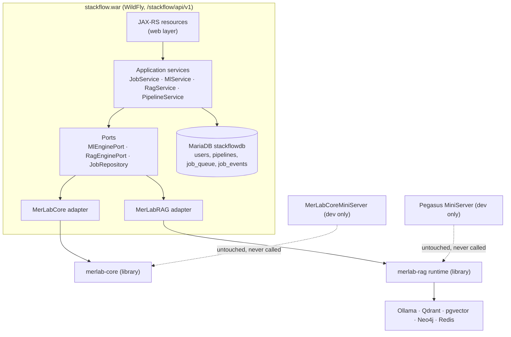
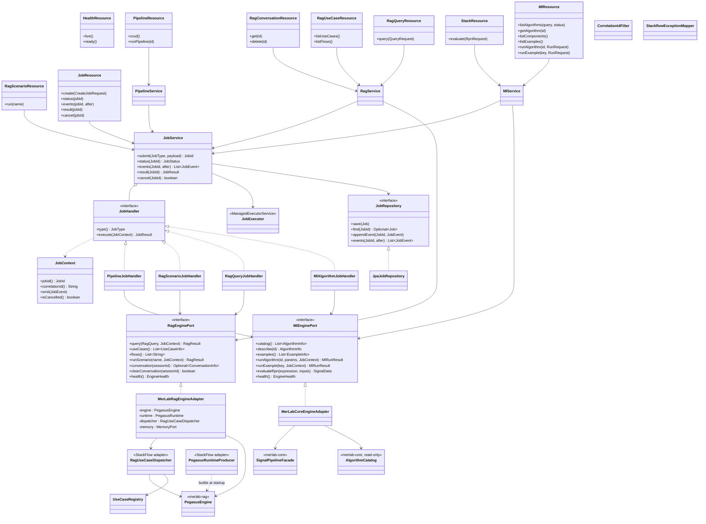
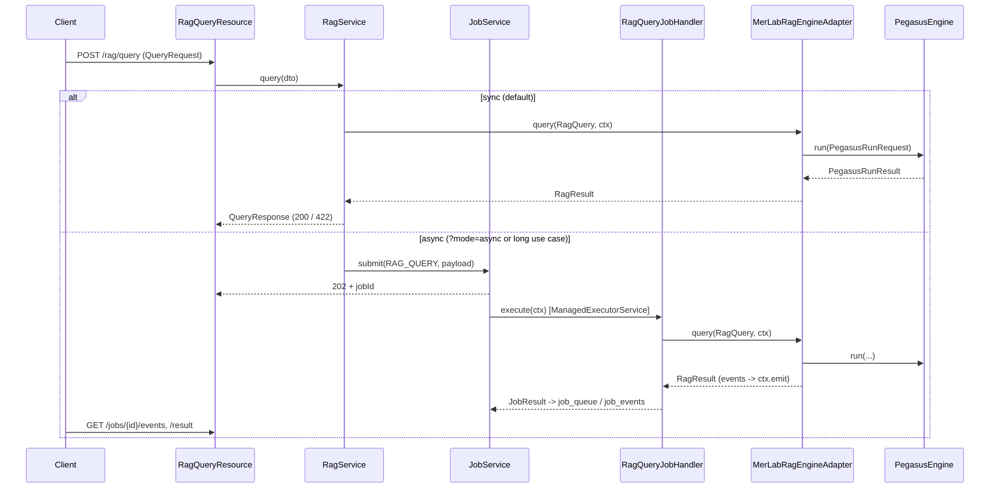

# Diseño REST unificado: StackFlowServer + MerLabRAG

> **Copia canónica para la implementación v2** (rama `v2`, `docs/v2/design/`). Los roles definitivos son `VIEWER`, `ANALYST`, `AUDITOR` y `ADMIN` (Anexo A.5 de DISENO_REST_UNIFICADO.md).


Versión 1 · 15.10.2026 · Solo diseño, no se ha cambiado código.
Reemplaza a `RAG_Integration_Analyse.md`. Aquel análisis suponía que había que conectar el RAG de la empresa; no es así.

---

## 1. Decisiones de partida

| # | Decisión |
|---|---|
| D1 | **Un solo servidor de aplicaciones** (WildFly) y **un solo WAR** (`stackflow.war`). No hay dos servidores en paralelo. |
| D2 | **MerLabCore** (ML y procesamiento) y **MerLabRAG** (motor *Pegasus*) se usan como **librerías**. El REST no contiene lógica de ML ni de RAG. **MerLabCore y MerLabRAG no se modifican.** |
| D3 | Los endpoints RAG siguen la **forma del REST de la empresa** (`/query`, `/usecases`, `/jobs…`, `/conversations`, `/health`). Ese proyecto es solo una **referencia de contrato**: no se copia código, todo va en paquetes `com.merlab`. |
| D4 | **Los dos miniservers no se tocan** y el REST no los llama nunca: `MerLabCoreMiniServer` y `pegasus.devapp.miniserver.MiniServerRunner`. Sus endpoints son la **base mínima** que el REST también debe ofrecer y hacer funcionar (sección 5.6). |
| D5 | Hay **un único sistema de jobs** para ML y RAG, con el patrón `/jobs`, `/events` y `/result`. |
| D6 | La infraestructura es común para todo el servidor: modelo de errores, `X-Correlation-Id`, roles, OpenAPI y health. |
| D7 | **MerLabRAG es opcional.** Sin su JAR, StackFlow compila, despliega y funciona solo con MerLabCore; `/rag/*` responde `503 RAG_NOT_INSTALLED` (ver la nota final). |

---

## 2. Qué hay hoy

### 2.1 StackFlowServer (`com.merlab:stackflow`, Jakarta EE 10, Java 17)
- Terminado: CRUD de usuarios (`/users`), DTOs, 4 ExceptionMapper y 27 entidades JPA (MariaDB `stackflowdb`).
- Stubs vacíos: `LLMService`, `MemoryManager`, `config/mcp/*`, `JobOrchestrator`, `APILayer`.
- **Error:** hay dos clases `Application` con `@ApplicationPath("api")` (`StackflowApp` y `JakartaRestConfiguration`). Además, `StackflowApp` ejecuta `TestManager.runAllTests()` al arrancar.
- `merlabcore/RPNStack.java` duplica el RPN de MerLabCore.

### 2.2 MerLabCore (`com.merlab:merlab-core`, Java 17)
- Más de 700 algoritmos, `SignalPipelineFacade`, `rpn`, `llm`, `nn` y `ml`.
- Miniserver de desarrollo con `/`, `/cli`, `/command`, `/health` y `/examples`. El comando `/command` admite `list`, `list algorithms|components|all`, `search algorithms`, `describe algorithm`, `run algorithm <id>`, `run <key>` y `version`.
- El catálogo (`AlgorithmCatalog`, `AlgorithmDescriptor`, `AlgorithmStatus`) y `ExampleRegistry` están en el paquete `miniserver`.
- Dependencias de escritorio (JavaFX, XChart, waffle-jna) y JNI (`LlamaCppLoader`).

### 2.3 MerLabRAG (`com.merlab.rag:merlab-rag`, paquete `pegasus`, Java 17, propietario tuyo)
- Unas 1000 clases con arquitectura hexagonal real: `core/port` contiene 14 ports (`LlmPort`, `VectorStorePort`, `KnowledgeGraphPort`, `LexicalSearchPort`, `MemoryPort`, `AuditSinkPort`…). Las reglas se verifican con ArchUnit.
- Adaptadores: Ollama, Qdrant, pgvector, Neo4j, BM25 y Redis (memoria).
- Fachada estable: `PegasusEngine.run(PegasusRunRequest) → PegasusRunResult` y `listFlows()`. `PegasusRuntime.isHealthy()`.
- `UseCaseRegistry` / `UseCaseDefinition(id, title, description, type, defaultFlow, tags)`.
- `OrchestrationMode`: `LLM_DIRECT`, `SIMPLE_RAG`, `FULL_RAG`, `DIAGNOSTIC_SMOKE`.
- Miniserver de desarrollo con `/health`, `/flows`, `/use-cases`, `/query`, `/scenario`, `/command`, `/runs/latest`, `/run-logs`, `/run-logs/raw`, `/run-logs/analyze` y `/ui`.

**Hallazgos importantes para el servidor:**
1. **El cableado de los casos de uso vive en el miniserver.** Los casos reales (document, exegesis, music, bible, diagnostics…) son clases `*Runner` en `devapp`. Quien los selecciona y ejecuta es `MiniServerRunner` (6616 líneas). El motor `PegasusEngine` solo conoce los flows registrados, y hoy eso es `simple-qa` con pasos *Fake*.
2. **El runtime se fabrica en `devapp`** (`DevAppRuntimeFactory`) con pasos `Fake*`. Para el servidor, StackFlow lo monta con `RagApplicationBuilder` (8.3).
3. **La telemetría y los runs asíncronos** (`MiniServerRunTelemetry`, `RunLogWriter`) también están solo en el miniserver.
4. `slf4j-simple` es una dependencia de compilación y choca con el logging de WildFly.
5. Los secretos están en `config/local-secrets.properties`, que está bien ignorado por git. En el servidor deben venir de la configuración de WildFly o de variables de entorno.

---

## 3. Arquitectura



### 3.1 Módulos Maven

```
stackflow-parent/
├── stackflow-api                → DTO records, ErrorResponse, enums, OpenAPI annotations (sin lógica)
├── stackflow-service            → ports + application services + job system (CDI/EJB, sin JAX-RS)
├── stackflow-adapter-merlabcore → implementa MlEnginePort con merlab-core
├── stackflow-adapter-merlabrag  → implementa RagEnginePort con merlab-rag
└── stackflow-web (war)          → resources, filters, exception mappers, security, producers
```

Dependencias externas:
- `merlab-core`: el JAR tal cual; JavaFX, XChart y waffle se excluyen con `<exclusions>` en el pom de StackFlow (8.2).
- `merlab-rag`: el JAR tal cual; `slf4j-simple` se excluye en el pom de StackFlow (8.3).

Regla de capas (comprobable con ArchUnit, como ya haces en MerLabRAG):
`web → service → port ← adapter`. `service` no importa `pegasus.*` ni `com.merlab.signals.*`.

---

## 4. Diagrama de clases (English)



`StackFlow adapter` marca clases nuevas que se escriben en StackFlow. Las librerías no cambian (sección 8).

---

## 5. Endpoints

Base: `http://<host>:8090/stackflow/api/v1`. Todas las respuestas son JSON, todos los errores usan `ErrorResponse` (sección 6) y todas las peticiones llevan `X-Correlation-Id`.

### 5.1 Comunes
| Método | Ruta | Rol | Descripción |
|---|---|---|---|
| GET | `/health/live` | público | el proceso está vivo |
| GET | `/health/ready` | público | DB, MerLabCore, Pegasus (`isHealthy`), Ollama y vector stores |
| GET | `/info` | USER | versión, motores, nº de algoritmos, flows, use cases |
| GET | `/admin/components` | ADMIN | estado de cada adaptador y componente externo |
| POST | `/auth/login` | público | emite el token (JWT) |
| GET/POST/PUT/DELETE | `/users`, `/users/{id}` | ADMIN | lo que ya existe |

### 5.2 ML: MerLabCore
| Método | Ruta | Descripción | Comando del miniserver |
|---|---|---|---|
| GET | `/ml/algorithms?q=&status=&tag=` | lista y búsqueda del catálogo | `list algorithms`, `search algorithms` |
| GET | `/ml/algorithms/{id}` | descripción de un algoritmo | `describe algorithm` |
| GET | `/ml/components` | componentes no ejecutables | `list components` |
| GET | `/ml/catalog` | catálogo completo | `list all` |
| GET | `/ml/examples` | ejemplos ejecutables | `list`, `/examples` |
| POST | `/ml/algorithms/{id}/runs` | ejecuta un algoritmo y devuelve `202` + `jobId` (o `200` con `?mode=sync` para ejecuciones cortas) | `run algorithm <id>` |
| POST | `/ml/examples/{key}/runs` | ejecuta un ejemplo y devuelve `202` + `jobId` | `run <key>` |
| POST | `/stack/evaluate` | evalúa una expresión RPN sobre señales (el núcleo "stack") | – |

El resultado de un run ML (`MlRunResult`) contiene `consoleOutput`, `metrics`, `chart` (Plotly JSON/HTML opcional) y `success`. Es el equivalente a `ExampleRunner.RunResult`, pero tipado.

### 5.3 Señales, pipelines y escenarios (diseño StackFlow)
| Método | Ruta | Descripción |
|---|---|---|
| CRUD | `/signals`, `/signals/{id}`, `/signals/{id}/data` | señales y datos |
| CRUD | `/signal-groups` | grupos |
| CRUD | `/pipelines`, `/pipelines/{id}/versions` | pipelines versionados (`pipeline_steps`) |
| POST | `/pipelines/{id}/runs` | ejecuta el pipeline y devuelve `202` + `jobId` |
| CRUD | `/scenarios` | escenarios ML |
| POST | `/scenarios/{id}/runs` | ejecuta el escenario y devuelve `202` + `jobId` |
| CRUD | `/models`, `/datasets` | modelos y datasets |

### 5.4 RAG: MerLabRAG (con la forma del REST de la empresa)
| Método | Ruta | Descripción | Base del miniserver |
|---|---|---|---|
| POST | `/rag/query` | consulta síncrona. Body: `QueryRequest` | `/query` |
| GET | `/rag/usecases` | casos de uso registrados | `/use-cases` |
| GET | `/rag/flows` | flows del motor | `/flows` |
| GET | `/rag/conversations/{sessionId}` | estado de la memoria | – |
| DELETE | `/rag/conversations/{sessionId}` | borra la memoria | – |
| POST | `/rag/scenarios/{name}/runs` | escenario técnico y devuelve `202` + `jobId` | `/scenario` |
| GET | `/rag/run-logs?limit=` | logs de ejecución (AUDITOR) | `/run-logs` |
| GET | `/rag/run-logs/{id}/raw` | log crudo | `/run-logs/raw` |
| GET | `/rag/run-logs/{id}/analysis` | análisis | `/run-logs/analyze` |
| POST | `/rag/indexing` | indexar fuentes (ADMIN) y devuelve `202` + `jobId` | (fase posterior) |

`QueryRequest` tiene los mismos campos que el contrato de la empresa:

```json
{
  "useCaseId": "document-summary",
  "sessionId": "s-123",
  "userInput": "¿Qué dice el capítulo 9 sobre …?",
  "orchestrationMode": "FULL_RAG"
}
```

`QueryResponse` también conserva la forma del contrato de la empresa:

```json
{
  "success": true,
  "valid": true,
  "useCaseId": "document-summary",
  "outputFormat": "TEXT",
  "finalOutput": "…",
  "artifacts": [ { "type": "SOURCE", "id": "rom-9-3", "score": 0.82, "text": "…" } ],
  "errors": [],
  "trace": { "traceId": "…", "flowName": "full-rag", "events": [ … ] },
  "auditResponse": { "validation": "PASSED", "quality": { … }, "security": "ALLOWED" }
}
```

Mapeo hacia Pegasus:

| REST | Pegasus |
|---|---|
| `useCaseId` | `UseCaseRegistry.findById()` (ya existe) → `RagUseCaseDispatcher` → `defaultFlow` o el `*Runner` del caso |
| `userInput` | `Query.of(text, metadata)` |
| `sessionId` | `metadata["sessionId"]` + `MemoryPort` |
| `orchestrationMode` | `OrchestrationMode.fromId()` |
| `success` / `valid` | `PegasusRunResult.isCompleted()` / estado de validación en `finalState` |
| `finalOutput` | `generatedText` |
| `trace.events` | `events` (`OperatorEvent`) |
| `errors` | `warnings` + `abortReason` |

### 5.5 Jobs (comunes para ML y RAG)
| Método | Ruta | Descripción |
|---|---|---|
| POST | `/jobs` | `{ "type": "RAG_QUERY", "payload": { … } }` y devuelve `202` + `Location` |
| GET | `/jobs?type=&status=&limit=` | lista (sustituye a `/runs/latest`) |
| GET | `/jobs/{jobId}` | estado: `PENDING`, `RUNNING`, `COMPLETED`, `FAILED` o `CANCELLED` |
| GET | `/jobs/{jobId}/events?after={seq}` | eventos incrementales (polling) |
| GET | `/jobs/{jobId}/result` | resultado (`409` si todavía no ha terminado) |
| DELETE | `/jobs/{jobId}` | cancelar |
| WS | `/ws/jobs/{jobId}` | streaming de eventos (opcional; reutiliza `SignalSocketEndpoint`) |

`JobType` puede ser `ML_ALGORITHM`, `ML_EXAMPLE`, `ML_PIPELINE`, `ML_SCENARIO`, `RAG_QUERY`, `RAG_SCENARIO` o `RAG_INDEXING`.

### 5.6 Garantía de la base mínima (miniservers → REST)

| Miniserver | Endpoint dev | REST v1 |
|---|---|---|
| MerLabCore | `/health` | `/health/live`, `/health/ready` |
| MerLabCore | `/examples` | `GET /ml/examples` |
| MerLabCore | `/command` (`list…`, `search`, `describe`, `run…`, `version`) | `/ml/*` (5.2) + `/info` |
| MerLabCore | `/`, `/cli` (UI) | no aplica: lo cubre FlowScope (Vue) |
| Pegasus | `/health` | `/health/ready` |
| Pegasus | `/flows` | `GET /rag/flows` |
| Pegasus | `/use-cases` | `GET /rag/usecases` |
| Pegasus | `/query` | `POST /rag/query` |
| Pegasus | `/scenario` | `POST /rag/scenarios/{name}/runs` |
| Pegasus | `/command` | operaciones tipadas de `/rag/*`; consola opcional `POST /admin/console` (ADMIN) |
| Pegasus | `/runs/latest` | `GET /jobs?type=RAG_QUERY&limit=1` |
| Pegasus | `/run-logs`, `/raw`, `/analyze` | `/rag/run-logs…` |
| Pegasus | `/ui` | no aplica: FlowScope |

Criterio de aceptación: por cada fila hay un test de integración (Arquillian) contra el WAR desplegado.

---

## 6. Infraestructura común

**Errores.** Un único `ErrorResponse`:

```json
{ "code": "RAG_ENGINE_UNAVAILABLE", "status": 503, "message": "…", "correlationId": "…", "details": [] }
```

| Código | HTTP |
|---|---|
| `VALIDATION_FAILED` | 400 |
| `NOT_FOUND` | 404 |
| `CONFLICT` / `JOB_NOT_FINISHED` | 409 |
| `UNPROCESSABLE_RESULT` (RAG `valid=false`) | 422 |
| `ENGINE_UNAVAILABLE` | 503 |
| `UPSTREAM_TIMEOUT` (Ollama, Qdrant…) | 504 |
| `INTERNAL_ERROR` | 500 |

Los 4 mappers actuales se unifican en una jerarquía `StackflowException` con un solo mapper y una política de detalle (sin stacktraces en producción).

**Roles** (propios, no los de la empresa): `VIEWER`, `ANALYST`, `AUDITOR` y `ADMIN` (ver Anexo A.5).

**Observabilidad.** `CorrelationIdFilter` → MDC → `JobContext` → `ObservabilityPort` de Pegasus.

**OpenAPI.** Se genera desde `stackflow-api` y Swagger UI se sirve en `/stackflow/api/openapi`.

**Configuración.** Se implementa por fin `ConfigProvider` (o MicroProfile Config de WildFly) con las claves `rag.ollama.url`, `rag.qdrant.*`, `rag.pgvector.datasource`, `rag.neo4j.*`, `rag.redis.*`, `rag.runtime.profile` y `ml.native.enabled`. Los secretos van en el vault de WildFly o en variables de entorno.

---

## 7. Datos (MariaDB `stackflowdb`)

| Tabla | Cambio |
|---|---|
| `job_queue` | ampliar con `type`, `status`, `payload_json`, `result_json`, `correlation_id`, `engine_run_id`, `created_by`, `started_at`, `finished_at` |
| `job_events` | **nueva**: `job_id`, `seq`, `ts`, `node`, `status`, `message` |
| `memory_slots` | solo caché de respuestas: `key = hash(useCase, mode, input)` |
| Conversaciones RAG | **no** van en MariaDB: usar el `MemoryPort` de Pegasus (Redis o InMemory) |
| Índices RAG | se quedan en Qdrant, pgvector y Neo4j (fuera de StackFlow) |

---

## 8. Qué se hace y dónde (no se hace ahora)

**Regla: MerLabCore y MerLabRAG no se modifican.** Se usan tal como están, como JAR. Todo el código nuevo vive en StackFlowServer, sobre todo en los módulos adaptadores.

### 8.1 StackFlowServer (núcleo)
1. Dejar una sola `Application` (`@ApplicationPath("api/v1")`) y quitar `runAllTests()` del arranque.
2. Convertir el proyecto a multi-módulo (3.1).
3. Borrar los stubs vacíos (`LLMService`, `MemoryManager`, `config/mcp/*`, `APILayer`) y el `RPNStack` duplicado.
4. Unificar los ExceptionMapper (6).

### 8.2 `stackflow-adapter-merlabcore` (usa MerLabCore sin cambiarlo)
1. **Dependencias:** en el `pom.xml` de StackFlow, `<exclusions>` para JavaFX, XChart y waffle-jna. MerLabCore no cambia.
2. **Catálogo:** el adaptador **lee** `AlgorithmCatalog`, `AlgorithmDescriptor` y `ExampleRegistry` (paquete `miniserver`) como clases normales: solo lectura, sin modificarlas y sin arrancar el miniserver. Si alguna no es pública o necesita algo del miniserver al iniciarse, se resuelve en el adaptador.
3. JNI (`LlamaCppLoader`): no se usa en el servidor (`ml.native.enabled=false`). El LLM va por Ollama.

### 8.3 `stackflow-adapter-merlabrag` (usa MerLabRAG sin cambiarlo)
`UseCaseRegistry` y `RagApplicationBuilder` **ya existen y se usan tal cual**. Lo que falta no está en la librería, sino en la parte de "arranque" que hoy solo hace el miniserver. Ese arranque se escribe en StackFlow:

1. **`PegasusRuntimeProducer`** (CDI, en StackFlow). Hace en el servidor lo que hoy hacen `DevAppRuntimeFactory` y `MiniServerRunner` en desarrollo:
   - `RagApplicationBuilder.create()` + `bindPort(LlmPort, new OllamaLlmAdapter(...))` + `bindPort(VectorStorePort, …)` + `registerFlow(...)`, con los adaptadores que ya trae MerLabRAG;
   - `UseCaseRegistry.of(...)` a partir de `FileYamlUseCaseProfileRegistry` o `PostgresJsonbUseCaseProfileRegistry` (igual que la línea 6376 de `MiniServerRunner`);
   - la configuración viene de WildFly, no de `local-secrets.properties`.
2. **`RagUseCaseDispatcher`** (en StackFlow). `UseCaseRegistry` **describe** los casos de uso (id, título, `defaultFlow`), pero **no los ejecuta**: los casos reales se ejecutan con sus clases `*Runner` (`UcA0SinglePassageAnswerRunner`, `MusicRagRunner`, `TechnicalScenarioRunner`…). Estas clases son públicas y se instancian igual que en el miniserver. El dispatcher solo dice: "para `useCaseId` X, llama al Runner Y". Si el caso de uso solo tiene un `defaultFlow`, se usa `PegasusEngine.run()`.
3. **Telemetría:** StackFlow implementa `ObservabilityPort` / `AuditSinkPort` (son interfaces de MerLabRAG) y los registra con `bindPort`. Así los eventos llegan al `JobContext` sin tocar la librería.
4. **Dependencias:** en el `pom.xml` de StackFlow, `<exclusions>` para `slf4j-simple`. Revisar los conflictos con WildFly (Jackson 2.21, gRPC/Netty de Qdrant) en `jboss-deployment-structure.xml`.
5. **Concurrencia:** probar si `PegasusRuntime` y los Runners se pueden usar desde varios hilos. Si no, el adaptador los serializa o crea un pool. Todo eso en StackFlow.

---

## 9. Secuencias



---

## 10. Plan por fases

> **Sustituido por [../ROADMAP.md](../ROADMAP.md)** (grupos 0, A–M). Esta tabla queda como referencia histórica.

| Fase | Contenido | Resultado |
|---|---|---|
| F0 | Correcciones de 8.1 (Application, arranque, stubs) | StackFlow despliega limpio |
| F1 | Módulos, `ErrorResponse`, filtro de correlación, `/health`, `/info` | esqueleto común |
| F2 | `MlEnginePort` + `/ml/*` (base del miniserver MerLabCore) | paridad con el miniserver de MerLabCore |
| F3 | Sistema de jobs (`/jobs…`, `job_events`) | ML asíncrono |
| F4 | Adaptador 8.3 (`PegasusRuntimeProducer`, `RagUseCaseDispatcher`) + `RagEnginePort` + `/rag/query`, `/rag/usecases`, `/rag/flows` | RAG dentro del mismo servidor |
| F5 | Conversaciones, escenarios, run-logs, jobs RAG | paridad con el miniserver de Pegasus |
| F6 | Pipelines, escenarios ML, `/stack/evaluate`, auth JWT | diseño StackFlow completo |
| F7 | Indexing por REST, WebSocket de eventos, FlowScope | extras |

---

## 11. Riesgos

| Riesgo | Mitigación |
|---|---|
| Conflictos de classloading en WildFly (Jackson, Netty/gRPC, SLF4J) | `jboss-deployment-structure.xml`, dependencias `provided`, prueba de despliegue temprana en F4 |
| Pegasus no es thread-safe | prueba de carga en F4; pool o serialización |
| JNI de MerLabCore en el servidor | desactivado por defecto; LLM vía Ollama (adaptador de Pegasus) |
| Tamaño del WAR (drivers Qdrant, Neo4j, Postgres, SQLite, Jedis) | aceptable; los drivers JDBC como datasources de WildFly |
| El arranque (crear runtime y elegir Runner) existe dos veces: en el miniserver y en StackFlow | aceptado: es la consecuencia de no tocar las librerías (D4) |
| Parecido con el contrato de la empresa | solo la forma de los endpoints; código, paquetes y roles propios |

## 12. Decisiones abiertas

> **Estado al 15.10.2026:** O2 resuelta (lectura del catálogo existente). O3 resuelta: todo bajo `/api/v1`. O4 resuelta: ML asíncrono por defecto con `?mode=sync` opcional. O5 resuelta: JWT + API key ahora; OIDC opcional (roadmap M4.2). **O1 sigue abierta** (alias de `orchestrationMode`); se decide en el paso J3.1.

| # | Pregunta |
|---|---|
| O1 | `orchestrationMode`: ¿usar los valores de Pegasus (`LLM_DIRECT`, `SIMPLE_RAG`, `FULL_RAG`, `DIAGNOSTIC_SMOKE`) o aceptar también `SIMPLE`/`GRAPH` como alias para mantener compatibilidad con el contrato de la empresa? |
| O2 | ~~Catálogo de MerLabCore~~ → resuelto: lectura de las clases existentes (8.2) |
| O3 | Prefijo de versión: ¿`/api/v1` para todo, o mantener `/api` sin versión para `/users`? |
| O4 | Umbral entre síncrono y asíncrono: ¿por caso de uso (en `UseCaseDefinition.tags`) o siempre asíncrono para ML? |
| O5 | Auth: ¿JWT propio ahora, o Keycloak/OIDC de WildFly más adelante? |

---

## Nota: endpoints RAG añadidos (15.10.2026)

Cuatro endpoints más para la memoria de conversación y los logs:

| # | Método | Ruta | Rol | Descripción |
|---|---|---|---|---|
| 1 | GET | `/rag/conversations` | AUDITOR | lista de todas las conversaciones con sus datos (`sessionId`, número de mensajes, última actividad), no solo los ids |
| 2 | GET | `/rag/conversations/{sessionId}/messages` | AUDITOR | contenido de la conversación: cada mensaje con rol, contenido y fecha |
| 3 | DELETE | `/rag/conversations/{sessionId}` | ADMIN | borra una conversación |
| 4 | GET | `/rag/run-logs/{id}` | AUDITOR | log completo de una ejecución, no solo el resumen |

Notas técnicas (sin modificar MerLabRAG):
- **(2) y (3)** usan el `MemoryPort` existente: `retrieve(sessionId, max, ctx)` y `clear(sessionId, ctx)`.
- **(1)** no es posible con `MemoryPort`, porque ese port no tiene ningún método para listar sesiones. El adaptador de StackFlow lee directamente de Redis (recorre las claves de sesión con `SCAN`). Con `InMemoryConversationMemory` no se puede listar: el endpoint responde `409 CAPABILITY_NOT_SUPPORTED`.
- **(4)** lo resuelve `RunLogReader` (solo lectura del directorio de logs).

---

## Nota: StackFlow sin MerLabRAG (15.10.2026)

**Requisito:** si la librería MerLabRAG no está instalada en Maven (`~/.m2`), StackFlowServer debe **compilar, desplegar y funcionar solo con MerLabCore**. El RAG es opcional.

### Compilación: perfil Maven `rag`
- El módulo `stackflow-adapter-merlabrag` y su dependencia `com.merlab.rag:merlab-rag` **solo** están dentro del perfil `rag`.
- El perfil se activa solo si el JAR está instalado:
  ```xml
  <profile>
    <id>rag</id>
    <activation>
      <file>
        <exists>${user.home}/.m2/repository/com/merlab/rag/merlab-rag/0.1.0-SNAPSHOT/merlab-rag-0.1.0-SNAPSHOT.jar</exists>
      </file>
    </activation>
    <modules>
      <module>stackflow-adapter-merlabrag</module>
    </modules>
  </profile>
  ```
  En `stackflow-web` la dependencia del adaptador está en el mismo perfil.
- Forzar: `mvn install -Prag`. Desactivar aunque el JAR esté instalado: `mvn install -P!rag`.
- Sin el JAR, `mvn install` termina bien y genera un WAR **sin RAG**.

### Ejecución: adaptador por defecto "sin RAG"
- En `stackflow-service` hay un `UnavailableRagEngine` (`@ApplicationScoped`) que implementa `RagEnginePort`:
  - `health()` devuelve `NOT_INSTALLED`;
  - el resto de los métodos lanzan `RagNotInstalledException`.
- `MerLabRagEngineAdapter` lleva `@Alternative @Priority(100)`. Si está en el WAR, CDI lo elige automáticamente en lugar del de por defecto. No hay ningún `if` en el código.
- `PegasusRuntimeProducer` solo existe en el módulo opcional. Sin él no se intenta arrancar Pegasus.

### Comportamiento

| Parte | Con MerLabRAG | Sin MerLabRAG |
|---|---|---|
| `/ml/*`, `/stack`, `/pipelines`, `/scenarios`, `/signals`, `/users` | normal | normal |
| `/jobs` de tipo `ML_*` | normal | normal |
| `/rag/*` (los 13 endpoints) | normal | `503` + `ErrorResponse(code=RAG_NOT_INSTALLED)` |
| `POST /jobs` de tipo `RAG_*` | normal | `503 RAG_NOT_INSTALLED`; **no** se crea el job |
| `/health/ready` | estado del RAG (UP, DEGRADED, DOWN) | `UP` global; componente `merlabrag: NOT_INSTALLED` (no cuenta como fallo) |
| `/info` | `engines.merlabrag = "UP"` | `engines.merlabrag = "NOT_INSTALLED"` |
| OpenAPI / Swagger | todos los endpoints | todos los endpoints (los de RAG documentan el `503`) |

Por qué `503` y no `404`: el endpoint existe y está documentado, pero el motor no está disponible en esta instalación. Así el cliente (FlowScope) puede ocultar la parte de RAG al leer `/info`.

### Protecciones
1. **ArchUnit:** `stackflow-service` y `stackflow-web` no importan `pegasus..`. Solo `stackflow-adapter-merlabrag` puede hacerlo.
2. **CI / build de prueba:** un build con `-P!rag` y los tests de la sección 5.6 de la parte ML, más un test que comprueba que `/rag/query` responde `503 RAG_NOT_INSTALLED`.
3. **Handlers de jobs RAG:** están en `stackflow-service` y solo usan `RagEnginePort`, así que compilan sin MerLabRAG.

### Simetría
El mismo patrón sirve para MerLabCore (`UnavailableMlEngine`), pero **no se aplica**: MerLabCore es la base de StackFlow y es obligatorio.

Diagramas de clases, estado y secuencia: `DISENO_CLASES_REST.md`, secciones 2, 3.10, 4.6 y 5.6.

---

## Anexo A: módulos del diseño original (v1) incluidos en v2

**Origen:** `StachFlowServer_dev_design.docx`, `StachFlowServer_dev.odt`, `README.md` (v1) y `docs/sqlscript_stackflowdb.sql`. Regla: *mejor que sobre a que falte*. Todo lo que estaba en el diseño original entra en v2, adaptado a la arquitectura hexagonal (resource → service → port ← adapter).

### A.1 Correspondencia v1 → v2

| Módulo v1 | En v2 | Grupo del roadmap |
|---|---|---|
| APILayer (REST + scripting) | `stackflow-web` + `/scripts` (Merlynx) | B, L |
| User + UserRole (ADMIN, ANALYST, VIEWER) | `/users`, roles ADMIN, ANALYST, VIEWER, AUDITOR | C |
| Autenticación (JWT / API key / OAuth) | JWT + API key; OAuth/OIDC opcional al final | C, M |
| Orchestrator | `JobService` + `JobExecutor` + `ScheduleService` | D |
| BatchProcessor + Worker + chunks | `BatchProcessor` (carril paralelo, chunks configurables) | G |
| StreamProcessor + Buffer + ventanas + EventListener | `/streams`, buffers acotados, ventanas, WS/REST/JMS | I |
| Alerting | `/alert-rules`, `/alerts`, WS `/ws/alerts` | I, K |
| RPNStack + StackElement + Operation | `/stack/evaluate` + sesiones de stack con estado | E |
| ScenarioManager + Scenario (save, load, run, compare, golden) | `/scenarios` + compare + golden + regresión | G |
| Archiving (versiones, rollback) | `/archives` + rollback | G |
| Monitor (log, report, metrics, alerts) | `/admin/metrics`, métricas Prometheus, alertas de umbral | K |
| PluginManager (load, unload, list) | `/admin/plugins` + SPI de plugins | L |
| MLCore (train, predict, load, save model) | `/models` + train + predict | H |
| MerLabCore | `MlEnginePort` + adaptador | E |
| DBAdapter + multi-DB | `/db-connections` (MariaDB, PostgreSQL) + import | F |
| Config (`ConfigProvider` local/remoto) | `/admin/config` + `ConfigProvider` | C |
| SignalProcessorMDB (JMS) | adaptador JMS de ingesta de streams | I |
| SignalSocketEndpoint (WebSocket) | `/ws/jobs/{id}`, `/ws/streams/{id}/…`, `/ws/alerts` | D, I |
| Merlynx (scripting / MCP) | `/scripts` + spike Merlynx/MCP | L |
| Fuentes realtime (JForex, Kafka, RabbitMQ) | adaptadores opcionales de `StreamSourcePort` | I |
| FlowScope (Vue 3) | cliente; contrato vía OpenAPI + CORS | B, M |

### A.2 Tablas del esquema original y su uso en v2

Las 27 tablas originales se mantienen (migración base `V001`). Se añaden: `job_events`, `api_keys`, `archives`, `streams`, `alert_rules`, `alert_events` y `plugins`.

| Tablas | Endpoints v2 |
|---|---|
| users, roles, user_roles | `/users`, `/users/{id}/roles` |
| user_settings | `/users/me/settings` |
| projects, project_users | `/projects`, `/projects/{id}/members` |
| datasets | `/datasets` |
| signals, signal_data | `/signals`, `/signals/{id}/data` |
| signal_groups, signal_group_signals | `/signal-groups`, `/signal-groups/{id}/signals` |
| models, model_files | `/models`, `/models/{id}/files`, train, predict |
| pipelines, pipeline_steps, pipeline_versions, pipeline_current_version | `/pipelines…` |
| history | `/history` |
| memory_slots | caché interna (sin endpoint propio) |
| config | `/admin/config` |
| scenarios, scenario_entities, scenario_runs | `/scenarios…` |
| job_queue (+ job_events) | `/jobs…` |
| post_process_tasks | `/jobs/{id}/post-process-tasks` |
| db_connections | `/db-connections` |
| schedules | `/schedules` |

### A.3 Endpoints añadidos (base `/stackflow/api/v1`)

| Área | Método | Ruta | Rol mínimo |
|---|---|---|---|
| Auth | POST | `/auth/login` | público |
| Auth | GET | `/auth/me` | VIEWER |
| Auth | GET, POST | `/api-keys` | VIEWER (propias) |
| Auth | DELETE | `/api-keys/{id}` | VIEWER (propias) / ADMIN |
| Usuarios | PUT | `/users/{id}/roles` | ADMIN |
| Usuarios | GET, PUT | `/users/me/settings` | VIEWER |
| Proyectos | CRUD | `/projects`, `/projects/{id}` | ANALYST |
| Proyectos | GET, POST, DELETE | `/projects/{id}/members[/{userId}]` | ANALYST (owner) |
| Config | GET | `/admin/config` | ADMIN |
| Config | PUT, DELETE | `/admin/config/{key}` | ADMIN |
| Historial | GET | `/history?entity=&user=&from=&to=` | AUDITOR |
| Señales | POST | `/signals/{id}/data` (JSON/CSV) | ANALYST |
| Señales | GET | `/signals/{id}/data?offset=&limit=` | VIEWER |
| Grupos | PUT, DELETE | `/signal-groups/{id}/signals/{signalId}` | ANALYST |
| BD externas | CRUD | `/db-connections` | ANALYST |
| BD externas | POST | `/db-connections/{id}/test` | ANALYST |
| BD externas | POST | `/db-connections/{id}/import` → job `DATA_IMPORT` | ANALYST |
| Stack | GET | `/stack/operations` | VIEWER |
| Stack | POST | `/stack/sessions` | ANALYST |
| Stack | GET, DELETE | `/stack/sessions/{id}` | ANALYST |
| Stack | POST | `/stack/sessions/{id}/push`, `/pop`, `/apply` | ANALYST |
| Stack | GET | `/stack/sessions/{id}/snapshot` | ANALYST |
| Pipelines | GET, POST | `/pipelines/{id}/steps` | ANALYST |
| Pipelines | PUT | `/pipelines/{id}/current-version` | ANALYST |
| Escenarios | GET, POST | `/scenarios/{id}/entities` | ANALYST |
| Escenarios | GET | `/scenarios/{id}/runs` | VIEWER |
| Escenarios | GET | `/scenarios/{id}/runs/{a}/compare/{b}` | ANALYST |
| Escenarios | PUT | `/scenarios/{id}/golden` | ANALYST |
| Escenarios | POST | `/scenarios/golden/runs` → job `SCENARIO_REGRESSION` | ANALYST |
| Archivo | GET | `/archives?entityType=&entityId=` | VIEWER |
| Archivo | GET | `/archives/{id}` | VIEWER |
| Archivo | POST | `/archives/{id}/rollback` | ANALYST |
| Modelos | GET, POST | `/models/{id}/files` | ANALYST |
| Modelos | GET | `/models/{id}/files/{fileId}` (descarga) | ANALYST |
| Modelos | POST | `/models/{id}/train` → job `ML_TRAIN` | ANALYST |
| Modelos | POST | `/models/{id}/predict` (sync o `?mode=async` → `ML_PREDICT`) | ANALYST |
| Schedules | CRUD | `/schedules` (cron) | ANALYST |
| Schedules | POST | `/schedules/{id}/pause`, `/resume` | ANALYST |
| Post-proceso | GET, POST | `/jobs/{id}/post-process-tasks` | ANALYST |
| Streams | CRUD | `/streams` | ANALYST |
| Streams | POST | `/streams/{id}/start`, `/stop` | ANALYST |
| Streams | POST | `/streams/{id}/events` | ANALYST / API key |
| Streams | WS | `/ws/streams/{id}/ingest`, `/ws/streams/{id}/results` | ANALYST |
| Alertas | CRUD | `/alert-rules` | ANALYST |
| Alertas | GET | `/alerts?state=&from=` | VIEWER |
| Alertas | PUT | `/alerts/{id}/ack` | ANALYST |
| Alertas | WS | `/ws/alerts` | VIEWER |
| Monitor | GET | `/admin/metrics` (JSON) | ADMIN |
| Monitor | — | Prometheus: `/metrics` de WildFly (puerto de gestión) | — |
| Plugins | GET | `/admin/plugins` | ADMIN |
| Plugins | POST | `/admin/plugins` (registrar JAR) | ADMIN |
| Plugins | POST | `/admin/plugins/{id}/enable`, `/disable` | ADMIN |
| Plugins | DELETE | `/admin/plugins/{id}` | ADMIN |
| Scripting | GET | `/scripts/languages` | ANALYST |
| Scripting | POST | `/scripts/run` → job `SCRIPT` | ANALYST |

### A.4 Tipos de job añadidos

`DATA_IMPORT`, `ML_TRAIN`, `ML_PREDICT`, `SCENARIO_REGRESSION`, `POST_PROCESS`, `SCRIPT` y `TEST_ECHO` (solo tests). Se suman a los de la sección 5.5 (`ML_ALGORITHM`, `ML_EXAMPLE`, `ML_PIPELINE`, `ML_SCENARIO`, `RAG_QUERY`, `RAG_SCENARIO`, `RAG_INDEXING`). Los streams no son jobs: son procesos de larga duración gestionados por `StreamService`.

### A.5 Roles (sustituyen a los nombres provisionales)

| Rol | Puede |
|---|---|
| `VIEWER` | leer catálogos, señales, resultados, alertas y sus propios ajustes |
| `ANALYST` | todo lo de VIEWER + crear y ejecutar (ML, RAG, pipelines, escenarios, streams, modelos, scripts) |
| `AUDITOR` | todo lo de VIEWER + historial, run-logs, conversaciones RAG y auditoría |
| `ADMIN` | todo, incluida la administración (usuarios, roles, config, plugins, métricas, borrar conversaciones) |

En las tablas de endpoints anteriores, "USER" equivale a `VIEWER` (lectura) o `ANALYST` (ejecución), según la operación.
