# StackFlowServer v2: diseño, revisión 2

Versión 2 · 15.10.2026 · Aprobada con ROGER.

**Precedencia:**
1. [DECISIONES.md](DECISIONES.md) (DA-xxx)
2. **este documento**
3. [DISENO_REST_UNIFICADO.md](DISENO_REST_UNIFICADO.md) y [DISENO_CLASES_REST.md](DISENO_CLASES_REST.md)

Los documentos 3 siguen siendo válidos en todo lo que este no cambia (modelo de errores, filtros, ciclo de vida de los jobs, RAG por dentro, modo sin RAG…), con los **nombres traducidos** según la tabla de la sección 11. La documentación de referencia del usuario son sus notas de Obsidian (`MerLab-Oekosystem-Updated`, `StackFlowServer_Architektur`, `StackFlowServer_IDE_und_Entwicklungsstrategie` y `StackFlowServer_Server_und_Hexagonal_Architektur`).

---

## 1. Decisiones de alcance (del usuario, 15.10.2026)

| # | Decisión |
|---|---|
| S1 | **StackFlowServer es la runtime de MerLabCore**: operaciones del stack RPN + ML sobre señales y datos (cargar señal → FFT → algoritmo ML…). Los pipelines de MerLabCore son **el núcleo**. |
| S2 | **Primeras aplicaciones: audio y trading.** |
| S3 | Se suben **archivos de todo tipo**: WAV, imágenes, CSV, JSON, HDF5… |
| S4 | **`stackflow-registry`**: registro unificado de operaciones con descubrimiento y ejecución. |
| S5 | **PegasusRAG** (= MerLabRAG) usa el mismo REST **pero no se mezcla** con MerLabCore. Sus resultados se guardan como archivo o en BD y, si se quiere, se **cargan después como data/señal** al stack. |
| S6 | **El PC Windows no entrena modelos ni ejecuta LLMs.** Los LLM corren en los dos **Mac mini**. **ModelForge** se desarrolla aparte, en el Mac mini; StackFlow solo lo llama por **API remota**. La inferencia de los algoritmos clásicos de MerLabCore sí corre en StackFlow. |
| S7 | **Merlynix** (el lenguaje del stack RPN) todavía no existe y va **al final**, cuando todo esté integrado. |
| S8 | Mandan los nombres de módulos de Obsidian y los nombres de clases v1. |
| S9 | Estilo del núcleo: **DA-001, opción C** (EJB para servicios, Java puro para el motor). |
| S10 | Sin Spring en v2 (notas aparte en [FUTURO_SPRING.md](FUTURO_SPRING.md)). IDE: NetBeans + WildFly. |
| S11 | Hecho técnico: **MerLabCore ya trae su motor RPN** (`RPNEngine`, `RPNStack`, `RPNParser`, `RPNOperation`, unas 50 operaciones: `norm`, `fft`, filtros, `ma`, `deriv`…). StackFlow **no lo duplica**: lo expone, lo registra y lo ejecuta. |

---

## 2. Módulos

Nombres de Obsidian, adaptados a DA-001. Cada módulo se crea **en el primer micropaso que lo necesita**, no todos al principio.

| Módulo | Tipo | Estilo | Contenido principal |
|---|---|---|---|
| `stackflow-api-contract` | jar | Java + `jakarta.validation` | DTOs `*DTO` (records) |
| `stackflow-domain` | jar | **Java puro** | `StackElement`, `OperationDescriptor`, `PipelineDefinition`, `PipelineStep`, `Job`, `JobStatus`, `JobType`, `Scenario`… |
| `stackflow-ports` | jar | **Java puro** | `MerLabCorePort`, `PegasusRagPort`, `ModelForgePort`, `MerlynixPort` (grupo N) |
| `stackflow-rpn` | jar | **Java puro** + 1 EJB | `StackSession`, `StackElementCodec`, `RpnExpression` · EJB `RPNStackServiceBean` |
| `stackflow-registry` | jar | EJB | `OperationRegistryLocal` / `OperationRegistryBean` (`@Singleton`) |
| `stackflow-runtime` | jar | EJB | `ExecutionContext`, `ResourceManagerBean` (límites de memoria), `MonitorServiceBean` |
| `stackflow-jobs` | jar | EJB | `OrchestratorServiceBean`, `JobQueueServiceBean`, `WorkerServiceBean`, `ScheduleServiceBean`, `PostProcessServiceBean`, `JobHandler` |
| `stackflow-pipeline` | jar | EJB + Java puro | `PipelineServiceBean`, `PipelineExecutorBean`, `PipelineRunner` (puro), `BatchProcessorServiceBean`, `StreamProcessorServiceBean`, `Buffer` (puro), `ScenarioManagerBean`, `ArchivingServiceBean` |
| `stackflow-storage` | jar | EJB + JPA | entidades, `XDaoLocal` / `XDaoBean` (DBAdapter v1), `FileStorageServiceBean`, `DataManagerServiceBean`, importadores |
| `stackflow-security` | jar | EJB | `UserServiceBean`, `AuthServiceBean`, `JwtServiceBean`, `ApiKeyServiceBean` |
| `stackflow-application` | jar | EJB | servicios de aplicación transversales: `ProjectServiceBean`, `ConfigServiceBean` (`ConfigProvider`), `HistoryServiceBean`, `MLCoreServiceBean`, `PegasusRagServiceBean`, `ModelServiceBean` |
| `stackflow-adapter-merlabcore` | jar | Java puro + producer | `MerLabCoreAdapter` (implementa `MerLabCorePort`) |
| `stackflow-adapter-pegasus` | jar · **perfil `pegasus`** | Java puro + producer | `PegasusRagAdapter`, `PegasusRuntimeProducer` |
| `stackflow-adapter-modelforge` | jar · **perfil `modelforge`** | Java puro + producer | `ModelForgeRemoteAdapter` (cliente HTTP al Mac mini) |
| `stackflow-adapter-merlynix` | jar · grupo N | — | más adelante |
| `stackflow-adapter-jakarta` | jar | Jakarta | `XResource`, `ExceptionMapper`, filtros, `XSocketEndpoint`, `SignalProcessorMDB`, `XMapper` (DTO ↔ dominio) |
| `stackflow-host-wildfly` | **war** | Jakarta | `StackflowApplication`, `StartupBean`, `web.xml`, `jboss-web.xml`, `jboss-deployment-structure.xml`, configuración |

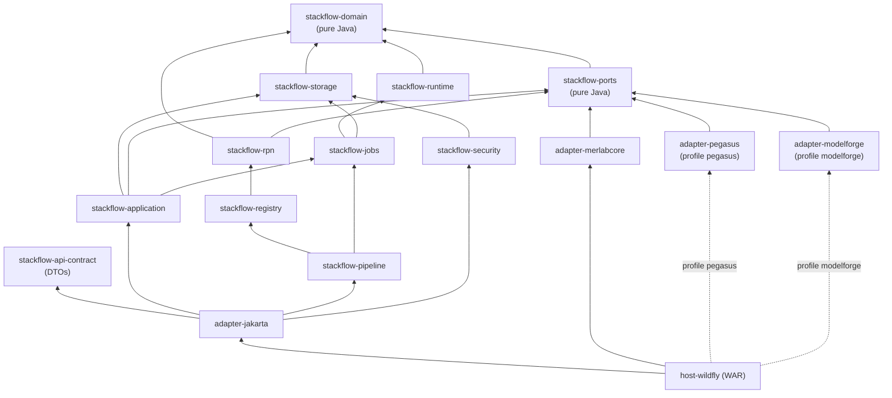

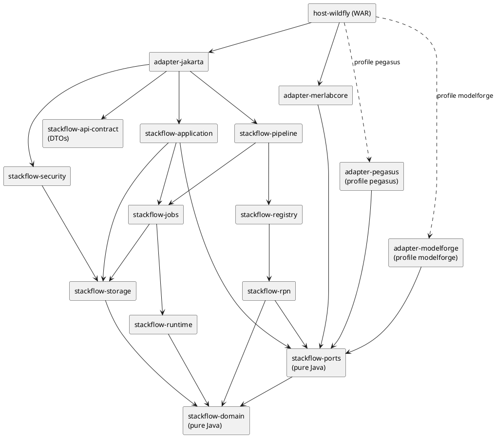

**Reglas de dependencia (ArchUnit):**
- `domain`, `ports` y las clases puras de `rpn` y `pipeline` no importan `jakarta.*`;
- solo `adapter-merlabcore` importa `com.merlab.signals..`;
- solo `adapter-pegasus` importa `pegasus..`;
- solo `adapter-modelforge` hace HTTP hacia ModelForge;
- nadie depende de `adapter-jakarta` salvo `host-wildfly`.

---

## 3. Despliegue con los recursos reales

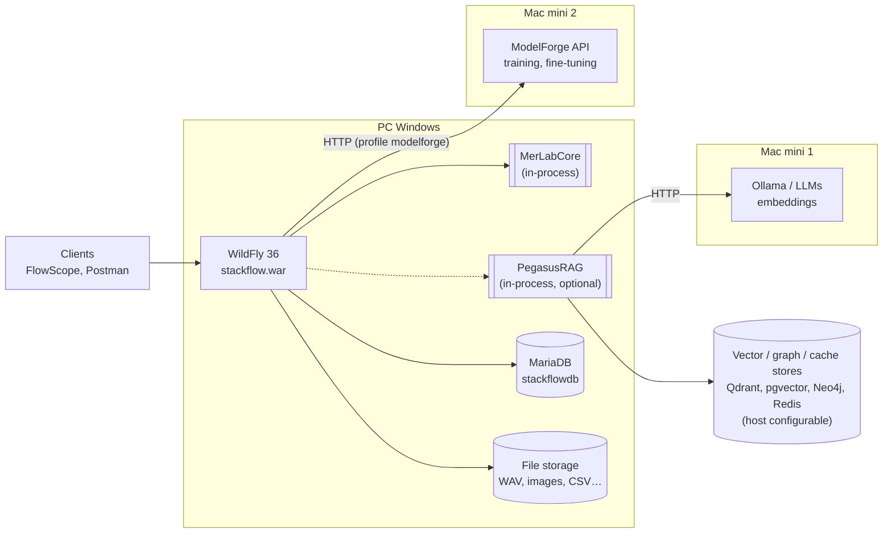

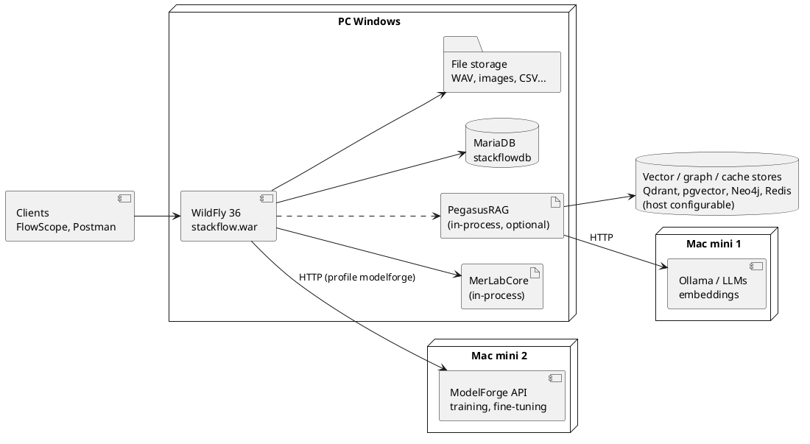

> La asignación concreta de servicios a cada Mac mini (qué LLM corre en cuál, dónde vive ModelForge) es configuración, no código. El diagrama solo es un ejemplo. URLs en `ConfigProvider`: `pegasus.ollama.url`, `modelforge.api.url`.

---

## 4. Convenciones de nombres (v1 + Obsidian)

| Tipo | Patrón | Ejemplo |
|---|---|---|
| DTO | `<Nombre>DTO` (record) | `UserDTO`, `JobDTO`, `ErrorDTO`, `PipelineRequestDTO`, `RagRequestDTO` |
| Servicio EJB | `<Nombre>ServiceLocal` (`@Local`) + `<Nombre>ServiceBean` | `UserServiceLocal` / `UserServiceBean` |
| Bean de rol especial | `<Nombre>Bean` + `<Nombre>Local` | `PipelineExecutorBean`, `ScenarioManagerBean`, `OperationRegistryBean` |
| DAO | `<Entidad>DaoLocal` + `<Entidad>DaoBean` | `UserDaoBean`, `JobQueueDaoBean`, `SignalDaoBean` |
| Entidad JPA | nombre en plural, como en v1 y en la tabla | `Users`, `Signals`, `JobQueue`, `Pipelines` |
| Mapper | `<Nombre>Mapper` (DTO ↔ dominio/entidad) | `UserMapper`, `JobMapper` |
| Resource | `<Nombre>Resource` | `UserResource`, `OperationResource` |
| WebSocket | `<Nombre>SocketEndpoint` | `SignalSocketEndpoint`, `JobSocketEndpoint` |
| MDB | `<Nombre>MDB` | `SignalProcessorMDB` |
| Port | `<Motor>Port` | `MerLabCorePort`, `PegasusRagPort` |
| Adaptador | `<Motor>Adapter` | `MerLabCoreAdapter`, `PegasusRagAdapter` |
| Motor no instalado | `Unavailable<Motor>` | `UnavailablePegasusRag`, `UnavailableModelForge` |
| Paquete raíz | `com.merlab.stackflow.<módulo>` | `com.merlab.stackflow.jobs` |

---

## 5. Motor RPN, registro y pipelines (núcleo S1/S4/S11)

**Idea:** MerLabCore ya sabe ejecutar `RPNOperation` sobre su `RPNStack` mediante `RPNEngine`. StackFlow añade lo que hace falta para un servidor:
- **registro** con metadatos (`OperationDescriptor`), que unifica las operaciones RPN y los algoritmos ML del catálogo;
- **elementos de stack serializables** (`StackElement`), para enviarlos por REST, guardarlos y hacer snapshots;
- **sesiones de stack** con límites de memoria;
- **pipelines**: definición `LOAD → tokens RPN / operaciones ML → SAVE` y su ejecución como job.

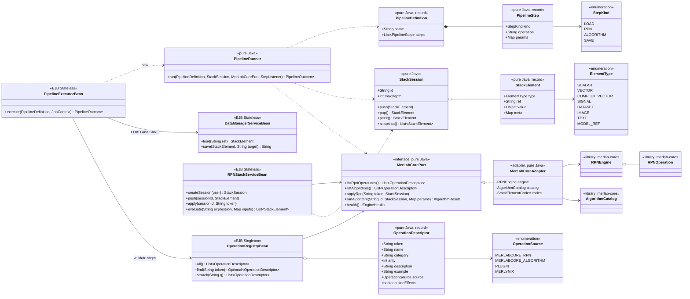

```plantuml
@startuml r2-rpn-core
left to right direction
skinparam classAttributeIconSize 0

package "stackflow-domain / stackflow-rpn (pure Java)" {
  class StackElement <<record>> {
    +type : ElementType
    +ref : String
    +value : Object
    +meta : Map<String,String>
  }
  enum ElementType {
    SCALAR
    VECTOR
    COMPLEX_VECTOR
    SIGNAL
    DATASET
    IMAGE
    TEXT
    MODEL_REF
  }
  class OperationDescriptor <<record>> {
    +token : String
    +name : String
    +category : String
    +arity : int
    +description : String
    +example : String
    +source : OperationSource
    +sideEffects : boolean
  }
  enum OperationSource {
    MERLABCORE_RPN
    MERLABCORE_ALGORITHM
    PLUGIN
    MERLYNIX
  }
  class StackSession {
    +id : String
    +maxDepth : int
    +push(StackElement)
    +pop() : StackElement
    +peek() : StackElement
    +snapshot() : List<StackElement>
  }
  class PipelineDefinition <<record>> {
    +name : String
    +steps : List<PipelineStep>
  }
  class PipelineStep <<record>> {
    +kind : StepKind
    +operation : String
    +params : Map<String,Object>
  }
  enum StepKind {
    LOAD
    RPN
    ALGORITHM
    SAVE
  }
  class PipelineRunner {
    +run(PipelineDefinition, StackSession, MerLabCorePort, StepListener) : PipelineOutcome
  }
}

package "stackflow-ports (pure Java)" {
  interface MerLabCorePort {
    +listRpnOperations() : List<OperationDescriptor>
    +listAlgorithms() : List<OperationDescriptor>
    +applyRpn(token, StackSession)
    +runAlgorithm(id, StackSession, params) : AlgorithmResult
    +health() : EngineHealth
  }
}

package "stackflow-adapter-merlabcore (pure Java)" {
  class MerLabCoreAdapter {
    -engine : RPNEngine
    -catalog : AlgorithmCatalog
    -codec : StackElementCodec
  }
}

package "EJB (registry, rpn, pipeline, storage)" {
  class OperationRegistryBean <<@Singleton>> {
    +all() : List<OperationDescriptor>
    +find(token) : Optional<OperationDescriptor>
    +search(q) : List<OperationDescriptor>
  }
  class RPNStackServiceBean <<@Stateless>> {
    +createSession(user) : StackSession
    +push(sessionId, StackElement)
    +apply(sessionId, token)
    +evaluate(expression, inputs) : List<StackElement>
  }
  class PipelineExecutorBean <<@Stateless>> {
    +execute(PipelineDefinition, JobContext) : PipelineOutcome
  }
  class DataManagerServiceBean <<@Stateless>> {
    +load(ref) : StackElement
    +save(StackElement, target) : String
  }
}

package "merlab-core.jar <<library>>" #EEEEEE {
  class RPNEngine
  interface RPNOperation
  class AlgorithmCatalog
}

StackElement --> ElementType
OperationDescriptor --> OperationSource
StackSession o-- StackElement
PipelineDefinition *-- PipelineStep
PipelineStep --> StepKind
PipelineRunner ..> PipelineDefinition
PipelineRunner ..> StackSession
PipelineRunner ..> MerLabCorePort
MerLabCorePort <|.. MerLabCoreAdapter
MerLabCoreAdapter --> RPNEngine
RPNEngine o-- RPNOperation
MerLabCoreAdapter --> AlgorithmCatalog
OperationRegistryBean --> MerLabCorePort
OperationRegistryBean o-- OperationDescriptor
RPNStackServiceBean --> MerLabCorePort
RPNStackServiceBean ..> StackSession
PipelineExecutorBean ..> PipelineRunner : new
PipelineExecutorBean --> DataManagerServiceBean : LOAD / SAVE
PipelineExecutorBean --> OperationRegistryBean : validate steps
@enduml
```

**Notas**
- Las operaciones con efectos secundarios de MerLabCore (`plot` abre ventanas; `save` escribe en disco) se marcan `sideEffects=true`. **No se exponen** por REST: `SAVE` lo gestiona StackFlow mediante `DataManagerServiceBean`, y los gráficos se devuelven como datos o HTML.
- Una expresión RPN completa (por ejemplo `"norm 8000 lp fft"`) se ejecuta con el `RPNParser` de MerLabCore. Los pipelines guardan sus pasos como lista estructurada (`PipelineStep`) para poder validarlos y versionarlos.
- Si para trading o audio falta alguna operación en MerLabCore (por ejemplo RSI o detección de picos), **la añade el usuario en MerLabCore** (Eclipse, fuera de este roadmap) o se aporta como plugin (grupo L). StackFlow nunca reimplementa algoritmos.

---

## 6. Archivos y datos (S3)

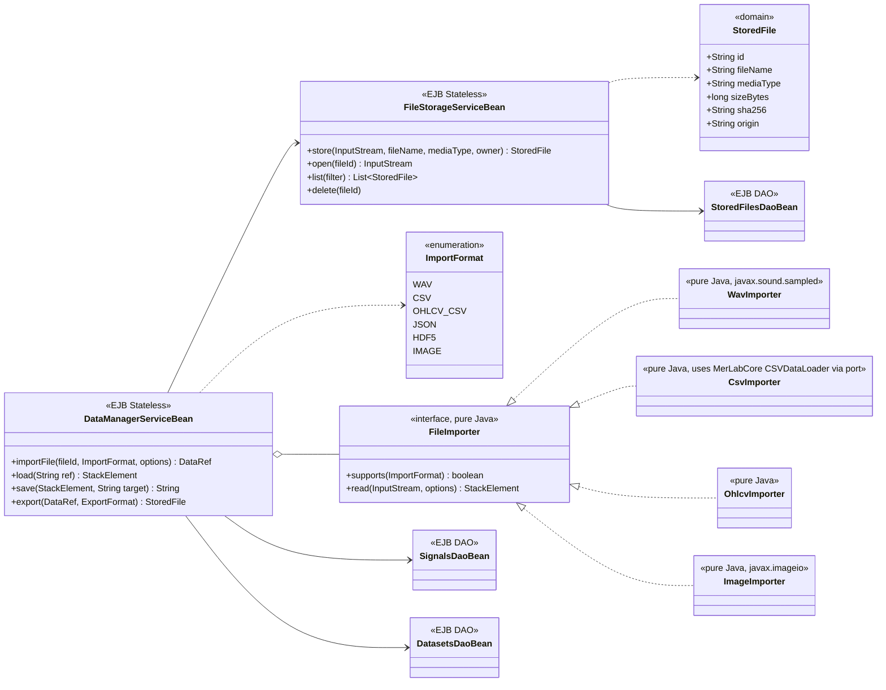

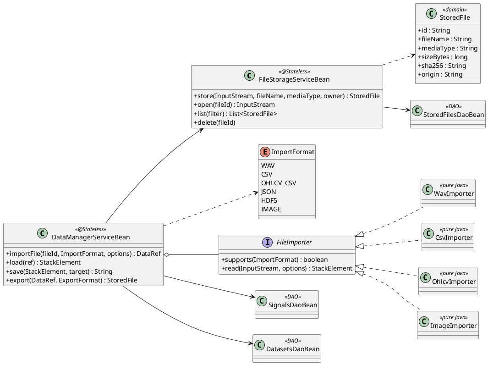

**Notas**
- Los binarios van a disco (`stackflow.storage.dir`, configurable) y sus metadatos a la tabla nueva `stored_files`. La BD nunca guarda archivos grandes.
- `WavImporter` usa solo el JDK (`javax.sound.sampled`) para convertir WAV en una señal MerLabCore (muestras + `sampleRate` en `meta`). Leer un archivo no es duplicar un algoritmo.
- `OhlcvImporter` convierte velas de trading (timestamp, open, high, low, close, volume) en un `DATASET` y en una señal por columna.
- `ImageImporter` (javax.imageio) convierte una imagen en matriz o vector. Qué operaciones de imagen existen depende de MerLabCore (spike).

---

## 7. Jobs: Orchestrator y Worker (v1)

Sustituye a `JobService`, `JobExecutor` y `JobHandlerRegistry` del diseño anterior. Los **estados y transiciones son los mismos** (DISENO_CLASES_REST §4.1).

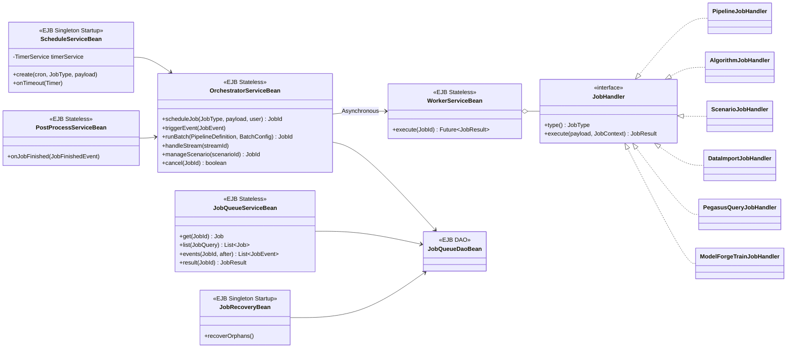

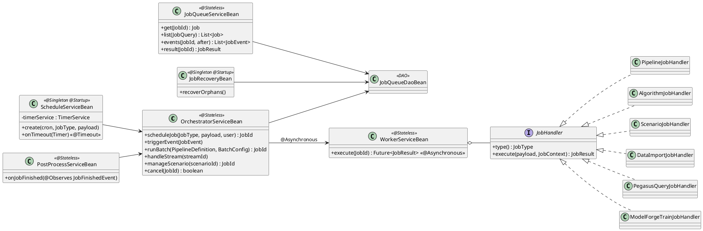

**Notas**
- `WorkerServiceBean.execute` es `@Asynchronous`: WildFly gestiona el pool de hilos. El "carril serie" del diseño anterior (para `ExampleRunner`, que captura `System.out`) se implementa con un `@Singleton` `@Lock(WRITE)` (`SerialExecutionBean`).
- Los schedules usan el **TimerService de EJB** (timers persistentes de WildFly), no un executor propio.

---

## 8. Motores opcionales (S5, S6, S7)

Mismo patrón para los tres: un port Java puro, un adaptador en un módulo con perfil Maven y un bean por defecto `Unavailable<Motor>` que responde **503 `ENGINE_NOT_INSTALLED`** (sustituye a `RAG_NOT_INSTALLED`; el detalle indica qué motor falta).

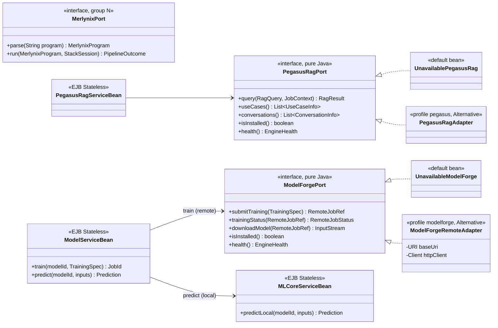

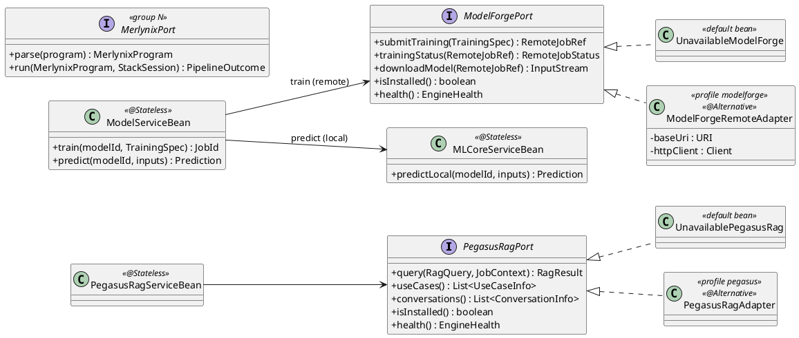

**Notas**
- **ModelForge:** su API todavía no existe. El contrato (`ModelForgePort`) se define en StackFlow y se ajusta cuando ModelForge publique su API (spike en el grupo H). Un entrenamiento es un job local de StackFlow (`MODELFORGE_TRAIN`) que solo envía la orden al Mac mini y consulta el estado; no consume recursos del PC.
- **Inferencia local:** solo la de los algoritmos clásicos de MerLabCore. Un modelo grande entrenado en ModelForge se usa por API remota, no en el PC.
- **PegasusRAG:** todo lo descrito en DISENO_CLASES_REST §3.6, §3.9, §3.10 y §4.6 sigue válido, renombrando según §11. El perfil Maven pasa a llamarse `pegasus`.

---

## 9. RAG separado: resultados al stack (S5)

PegasusRAG y MerLabCore **no se llaman entre sí**. El puente es el almacenamiento: un resultado de Pegasus se **exporta** a un archivo o dataset, y un pipeline de MerLabCore lo puede **cargar** con `LOAD`.

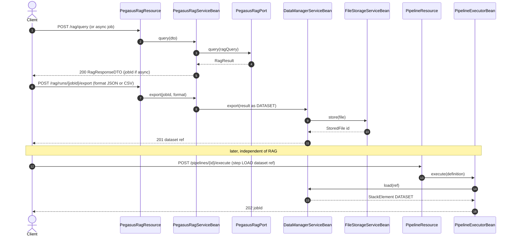

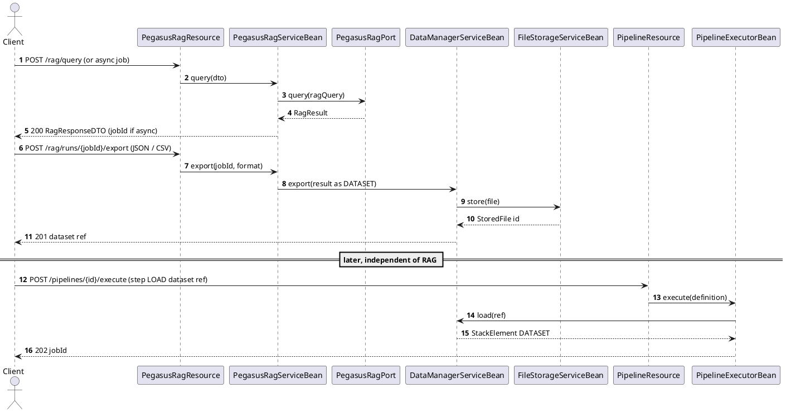

---

## 10. Primeras aplicaciones: audio y trading (S2)

### 10.1 Audio: `voice.wav → normalize → lowpass → FFT → picos → guardar`

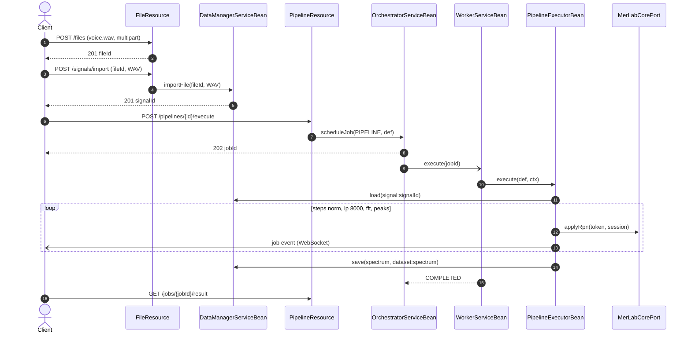

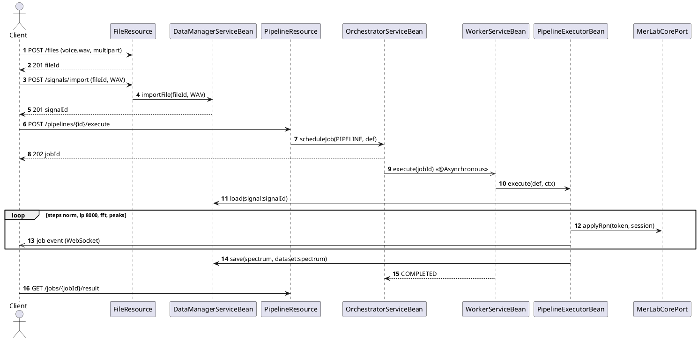

### 10.2 Trading: `velas OHLCV → medias móviles → derivada → algoritmo ML → señal`

Misma secuencia que 10.1, con:
1. `POST /datasets/import` (`OHLCV_CSV`);
2. pasos `LOAD close`, `ma 20`, `deriv`, `ALGORITHM <id>` (por ejemplo, regresión o clasificación del catálogo de MerLabCore) y `SAVE signal:prediction`.

Los indicadores que falten (RSI, MACD…) se añaden en MerLabCore, fuera de este roadmap. Ver la nota de §5.

---

## 11. Traducción de nombres (diseño anterior → revisión 2)

| Antes (DISENO_*.md) | Ahora |
|---|---|
| `stackflow-api` | `stackflow-api-contract` |
| `stackflow-service` | `stackflow-domain`, `stackflow-ports`, `stackflow-jobs`, `stackflow-pipeline`, `stackflow-rpn`, `stackflow-registry`, `stackflow-runtime`, `stackflow-security`, `stackflow-application` |
| `stackflow-persistence` | `stackflow-storage` |
| `stackflow-web` | `stackflow-adapter-jakarta` + `stackflow-host-wildfly` |
| `stackflow-adapter-merlabrag`, perfil `rag` | `stackflow-adapter-pegasus`, perfil `pegasus` |
| Records `XRequest`/`XResponse` | `XDTO` (p. ej. `QueryRequest` → `RagRequestDTO`, `QueryResponse` → `RagResponseDTO`, `ErrorResponse` → `ErrorDTO`, `JobResponse` → `JobDTO`) |
| `JobService` | `OrchestratorServiceBean` (crear, cancelar) + `JobQueueServiceBean` (consultar) |
| `JobExecutor` | `WorkerServiceBean` (`@Asynchronous`) + `SerialExecutionBean` |
| `JobHandlerRegistry` | lista de `JobHandler` dentro de `WorkerServiceBean` |
| `JpaJobRepository` / `JobRepository` | `JobQueueDaoBean` / `JobQueueDaoLocal` |
| `MlEnginePort` / `MerLabCoreEngineAdapter` | `MerLabCorePort` / `MerLabCoreAdapter` |
| `StackOperationCatalog` + `AlgorithmCatalogReader` | `OperationRegistryBean` |
| `StackSessionService` | `RPNStackServiceBean` + `StackSession` |
| `MlService` | `MLCoreServiceBean` |
| `RagEnginePort` / `MerLabRagEngineAdapter` / `UnavailableRagEngine` | `PegasusRagPort` / `PegasusRagAdapter` / `UnavailablePegasusRag` |
| `RagService` | `PegasusRagServiceBean` |
| `RAG_NOT_INSTALLED` | `ENGINE_NOT_INSTALLED` (detalle: `engine=pegasus`) |
| `HealthService` | `MonitorServiceBean` (`health()`, métricas) |
| `ApiMapper` | un `XMapper` por área |
| `/scripts` (grupo L, Merlynix) | grupo N: `/merlynix/*` |
| Entrenamiento local (`ML_TRAIN`) | `MODELFORGE_TRAIN` (remoto) |

## 12. Endpoints nuevos o cambiados (sobre el Anexo A)

| Método | Ruta | Descripción |
|---|---|---|
| GET | `/operations?q=&category=&source=` | registro unificado (S4) |
| GET | `/operations/{token}` | detalle de una operación |
| POST | `/operations/{token}/execute` | ejecutar una operación suelta sobre entradas en línea o refs (`signal:12`) |
| POST | `/stack/evaluate` | expresión RPN completa (`RPNParser` de MerLabCore) |
| POST | `/files` | subir cualquier archivo (multipart) |
| GET | `/files`, `/files/{id}`, `/files/{id}/content` | listar, metadatos, descargar |
| DELETE | `/files/{id}` | borrar |
| POST | `/signals/import` | `{fileId, format: WAV\|CSV\|JSON\|HDF5\|IMAGE}` → señal |
| POST | `/datasets/import` | `{fileId, format: CSV\|OHLCV_CSV\|JSON\|HDF5}` → dataset |
| GET | `/datasets/{id}/export?format=` | exportar a archivo |
| POST | `/pipelines/{id}/execute` | alias de `/pipelines/{id}/runs` (202 + job) |
| POST | `/rag/runs/{jobId}/export` | resultado de Pegasus → dataset/archivo (S5) |
| GET | `/modelforge/status` | estado del ModelForge remoto |
| POST | `/models/{id}/train` | job `MODELFORGE_TRAIN` (503 `ENGINE_NOT_INSTALLED` sin ModelForge) |
| — | `/scripts/*` | **eliminado**; pasa a `/merlynix/*` en el grupo N |
