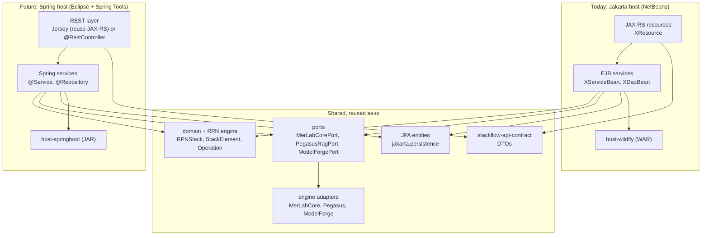
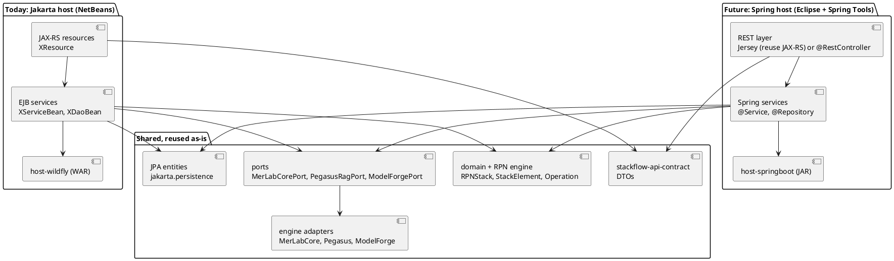

# StackFlowServer: notas para un futuro host Spring Boot

Estado: **solo notas, no planificado.** No forma parte del roadmap v2. Se retomará, si se decide, cuando StackFlow 2.0 esté estable (fases 5 y 6 de la nota de Obsidian "StackFlowServer – Application Server, REST und modulare Runtime-Architektur").

Contexto: la decisión [DA-001](DECISIONES.md) (Opción C) usa EJB para los servicios y Java puro para el motor. Con eso, un host Spring **reutiliza** el motor, los ports, los DTOs y las entidades, y **reescribe** los beans. Este documento dice qué se reutiliza, qué se reescribe y qué reglas hay que seguir **desde hoy** para que ese trabajo futuro sea barato.

---

## 1. Visión

Módulos nuevos que harían falta: `stackflow-adapter-spring` (servicios, seguridad, REST) y `stackflow-host-springboot` (arranque y configuración). Según la estrategia de IDE de Obsidian, se desarrollarían en **Eclipse + Spring Tools**.

---

## 2. Qué se reutiliza tal cual

| Parte | Por qué sirve en Spring |
|---|---|
| `stackflow-api-contract` (DTOs + Bean Validation) | Spring Boot 3 usa `jakarta.validation`, igual que Jakarta EE 10 |
| Dominio y motor RPN (`RPNStack`, `StackElement`, `Operation`, pasos de pipeline, escenarios, ventanas, chunks) | Java puro (DA-001) |
| Ports (`MerLabCorePort`, `PegasusRagPort`, `ModelForgePort`, `MerlynixPort`) | interfaces Java puras |
| Adaptadores de motores (MerLabCore, Pegasus, ModelForge), **si siguen la regla R3** | clases Java creadas por un pequeño producer |
| Entidades JPA | Spring Boot 3 también usa `jakarta.persistence` |
| Migraciones SQL (Flyway) | Spring Boot ejecuta Flyway automáticamente |
| Tests del motor (JUnit) | no dependen del contenedor |
| Tests HTTP de caja negra, **si siguen la regla R5** | se lanzan contra cualquier host cambiando la URL base |

## 3. Qué hay que reescribir (equivalencias)

| Jakarta EE / WildFly (hoy) | Spring Boot (futuro) | Esfuerzo |
|---|---|---|
| `@Stateless` / `XServiceBean` + `@Local XServiceLocal` | `@Service` (la interfaz `XServiceLocal` puede seguir como interfaz normal) | bajo por clase, pero son muchas |
| `@EJB` / `@Inject` | inyección por constructor | bajo |
| Transacciones JTA del contenedor | `@Transactional` (transacciones locales; JTA solo con Narayana/Atomikos) | medio |
| `XDaoBean` con `@PersistenceContext EntityManager` | `@Repository` con `EntityManager` (se mantiene casi igual) o Spring Data | bajo |
| `persistence.xml` + DataSource de WildFly | `application.yml` (`spring.datasource`, `spring.jpa`) | bajo |
| `@Asynchronous` (Worker) / `ManagedExecutorService` | `@Async` + `ThreadPoolTaskExecutor` | medio |
| `TimerService` / `@Schedule` (schedules cron) | `@Scheduled` o `ThreadPoolTaskScheduler` | medio |
| `@Singleton @Startup` | `ApplicationRunner` / `@PostConstruct` en un `@Component` | bajo |
| `@Singleton` + `@Lock` (registro de operaciones) | `@Component` + estructuras concurrentes | bajo |
| Eventos CDI (`@Observes`) | `ApplicationEventPublisher` + `@EventListener` | bajo |
| MDB (`SignalProcessorMDB`) | `@JmsListener` (Artemis) | medio |
| JAX-RS `XResource` | **opción 1:** Spring Boot + **Jersey** (se reutilizan los resources casi tal cual); **opción 2:** `@RestController` (reescritura) | bajo con Jersey / alto con MVC |
| `ExceptionMapper` | con Jersey se reutilizan; con MVC, `@ControllerAdvice` | bajo / medio |
| `ContainerRequestFilter` (correlación, CORS, JWT) | con Jersey se reutilizan; si no, `OncePerRequestFilter` | bajo / medio |
| `@RolesAllowed` + filtro JWT/API key | Spring Security (`jsr250Enabled = true` mantiene `@RolesAllowed`) + resource server JWT | medio |
| WebSocket `@ServerEndpoint` | funciona en Tomcat embebido con `ServerEndpointExporter` | bajo |
| Configuración (WildFly / MicroProfile Config) detrás de `ConfigProvider` | `@ConfigurationProperties`, con el mismo `ConfigProvider` por encima | bajo |
| Arquillian (tests de integración) | `@SpringBootTest` + los mismos tests HTTP | medio |
| Perfiles Maven `pegasus` / `modelforge` | los mismos perfiles | ninguno |

**Recomendación para entonces:** empezar con **Spring Boot + Jersey**. Mantiene JAX-RS, los `ExceptionMapper` y los filtros, así que el primer host Spring solo reescribe los servicios y la configuración. `@RestController` puede venir después, como ejercicio de aprendizaje.

## 4. Reglas de v2 para que Spring salga barato (DA-002)

**Estado: aprobadas (DA-002, ROGER del 15.10.2026).** Son obligatorias en todos los micropasos de v2. Cuestan muy poco y ahorran mucho trabajo después.

| # | Regla | Cómo se comprueba |
|---|---|---|
| R1 | Dominio, motor RPN y ports **sin `jakarta.*`** (salvo `jakarta.validation` en los DTOs). | ArchUnit |
| R2 | Los beans EJB son **delgados**: coordinan y delegan. Una lógica de más de unas decenas de líneas, o con varios caminos, va a una clase Java pura que el bean usa con `new`. | revisión en cada micropaso |
| R3 | Los adaptadores de motores (MerLabCore, Pegasus, ModelForge) son **clases Java normales**; un producer CDI pequeño las expone. No llevan `@Stateless` ni lógica de contenedor. | ArchUnit (sin `jakarta.ejb` en `adapter-merlabcore`, `adapter-pegasus`, `adapter-modelforge`) |
| R4 | Los servicios acceden a datos **siempre** por interfaces `XDaoLocal`, nunca con `EntityManager` directamente. | ArchUnit (solo `*DaoBean` usa `EntityManager`) |
| R5 | Los tests de integración de la API son **HTTP de caja negra** (REST-assured o el cliente JAX-RS) con la URL base como parámetro (`-Dstackflow.baseUrl`), sin depender de clases internas del servidor. | convención de los `*IT` |
| R6 | Toda la configuración se lee con `ConfigProvider` y claves constantes (`ConfigKeys`); nunca con APIs de WildFly en el código de negocio. | revisión |
| R7 | Las dependencias de terceros del motor no usan APIs exclusivas de WildFly (JBoss Logging solo en los beans; el motor usa `java.util.logging` o SLF4J). | revisión |
| R8 | La lógica de cada `ExceptionMapper` y de cada filtro vive en una clase Java pura (por ejemplo, `ErrorResponseFactory`) que el mapper usa. | revisión |

## 5. Esfuerzo estimado (orientativo)

| Bloque | Con Jersey | Con `@RestController` |
|---|---|---|
| Servicios y DAOs (~60–70 beans) | 2–3 semanas | 2–3 semanas |
| REST, mappers y filtros | 1–3 días | 1–2 semanas |
| Seguridad (JWT, API key, roles) | 3–5 días | 3–5 días |
| Jobs, async, schedules, JMS | 1 semana | 1 semana |
| Tests contra los dos hosts | 3–5 días | 3–5 días |

Las cifras son una estimación inicial: se revisarán con el tamaño real de v2 cuando se decida empezar.

## 6. Si se decide hacerlo: orden propuesto

1. **Spike:** Spring Boot 3 + Jersey + JPA, con un solo endpoint (`/health`) que use el motor RPN real.
2. `stackflow-host-springboot` con DataSource, Flyway y configuración.
3. `stackflow-adapter-spring`: servicios de usuarios y seguridad.
4. Jobs (async, schedules) y el motor RPN por REST.
5. Los tests HTTP de caja negra (R5) en verde contra **los dos** hosts.
6. Pegasus y ModelForge (perfiles).
7. Comparativa WildFly frente a Spring (rendimiento y memoria), tal como pide la fase 6 de las notas de Obsidian.

Proyecto aparte, no incluido aquí: el benchmark **Spring AI frente a PegasusRAG** (`spring-ai-benchmark`), según la nota de Obsidian.
